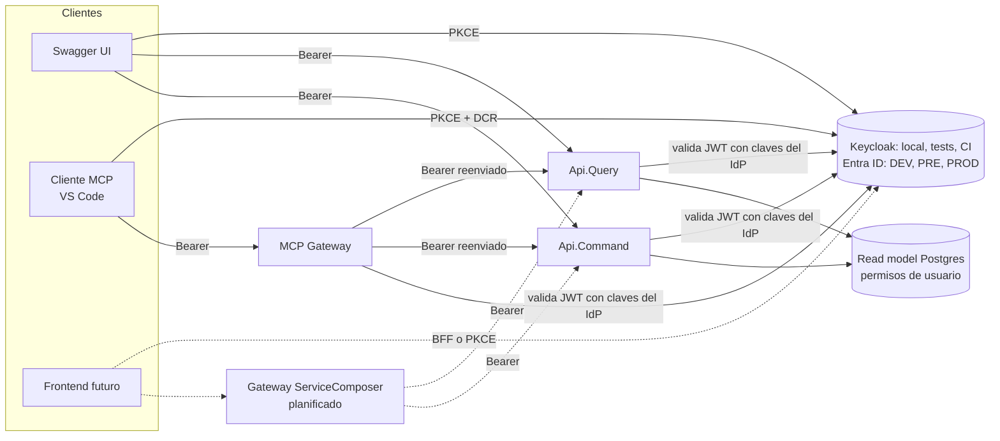
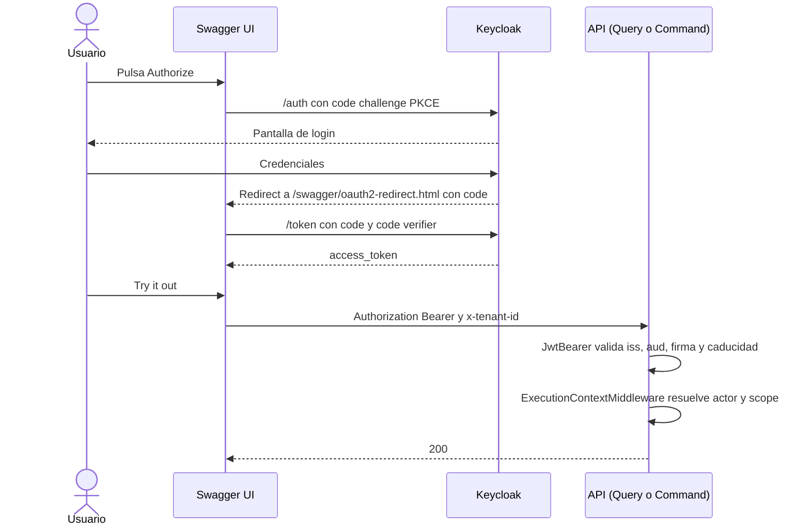
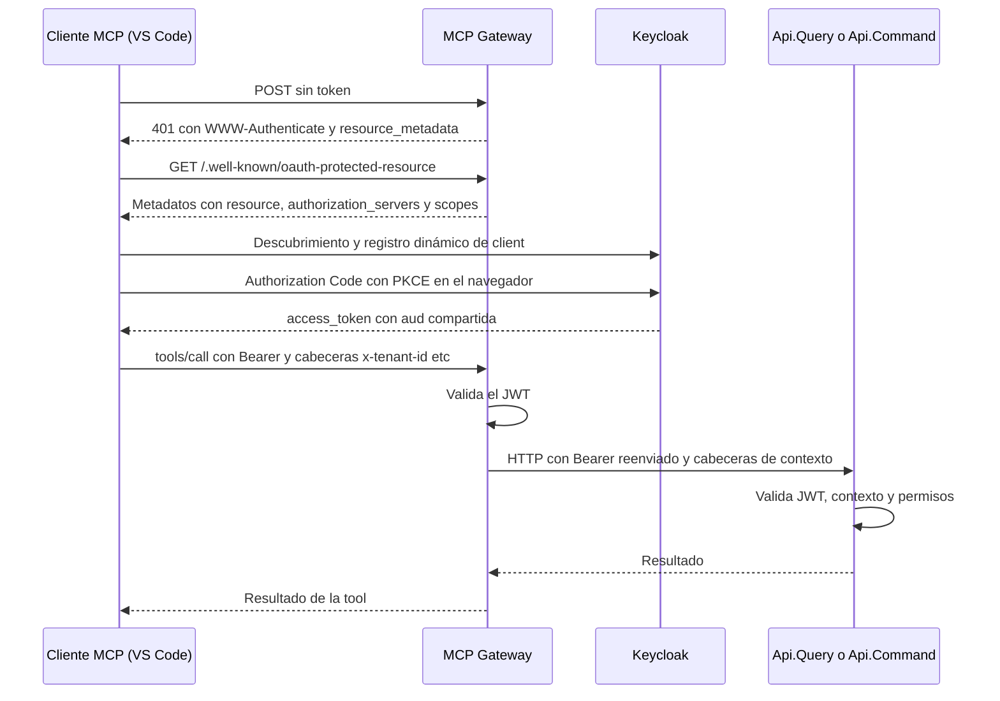

# Autenticación en Shared Kernel: diseño e implementación

> Guía para entender rápido y en detalle cómo se autentica y se contextualiza cada petición en el sistema:
> APIs (Query y Command), Swagger UI, MCP Gateway, gateway ServiceComposer (planificado), tests, Keycloak y Entra ID.

**Estado de cada pieza**

| Pieza | Estado |
|---|---|
| Api.Query y Api.Command con JWT (Keycloak en local, Entra ID configurado para cloud) | Implementado |
| Swagger UI con Authorization Code + PKCE | Implementado |
| Resolución de actor y contexto (`ExecutionContextMiddleware`) | Implementado |
| Código de autenticación compartido en `SharedKernel.Presentation.HttpRestfulApi` | Implementado |
| Tests funcionales (auth falsa) y System Tests (Keycloak real) | Implementado |
| MCP Gateway con OAuth (resource server) | Implementado (código entregado, pendiente de validar de extremo a extremo con VS Code) |
| Entra ID en DEV/PRE/PROD | Solo configuración con placeholders, **sin probar** |
| Gateway ServiceComposer delante de las APIs | Planificado |

## Índice

1. [Propósito y alcance](#1-propósito-y-alcance)
2. [Conceptos clave](#2-conceptos-clave)
3. [Arquitectura y reparto de responsabilidades](#3-arquitectura-y-reparto-de-responsabilidades)
4. [Cómo funciona](#4-cómo-funciona)
5. [Testing](#5-testing)
6. [Decisiones de diseño](#6-decisiones-de-diseño)
7. [Modelo mental](#7-modelo-mental)
8. [Beneficios](#8-beneficios)
9. [Casos esquina y resolución de problemas](#9-casos-esquina-y-resolución-de-problemas)
10. [Pendientes y riesgos abiertos](#10-pendientes-y-riesgos-abiertos)
11. [Referencia rápida](#11-referencia-rápida)

---

## 1. Propósito y alcance

**Objetivo:** que cada petición a las APIs (y a las tools del MCP) llegue con la identidad de un usuario real, validada
con un JWT emitido por un proveedor OIDC, y que esa identidad se convierta en un contexto de ejecución (actor, tenant,
partición, dominio) sobre el que se aplica la autorización de negocio.

**Requisitos que han guiado el diseño**

- **Dos proveedores, un solo código**: Keycloak en local, tests de integración, funcionales y pipelines; Entra ID en los
  entornos cloud (DEV → PRE → PROD). El código no debe conocer al proveedor.
- **Clean Architecture**: Domain y Application no saben nada de claims ni de JWT. Todo lo relativo a autenticación vive
  en la capa de presentación; el resto solo ve un `ExecutionContext`.
- **La autorización real está en cada aplicación** (permisos por tenant/partición/dominio). El gateway y el MCP solo
  autentican y propagan.
- **Sin duplicar configuración** entre Api.Query, Api.Command, MCP Gateway y futuros bounded contexts.
- **Reproducibilidad con Aspire**: `F5` levanta Keycloak ya configurado (realm importado) y las APIs reciben su
  configuración desde el AppHost.

**Fuera de alcance de este documento:** la autorización de dominio (roles/permisos de `User`), la caché Redis y el diseño
interno del gateway ServiceComposer.

---

## 2. Conceptos clave

| Concepto | Qué es en este sistema |
|---|---|
| **OIDC / OAuth2** | Estándar que usan Keycloak y Entra ID. Por eso un único `AddJwtBearer` basta para ambos. |
| **JWT (access token)** | Token firmado que la API valida: firma, `iss`, `aud` y caducidad. |
| **Authority** | URL del emisor (realm de Keycloak o tenant de Entra). De ahí se descargan los metadatos y las claves de firma. |
| **Issuer (`iss`)** | Quién emitió el token. Debe coincidir **exactamente** con el Authority (ojo con `localhost` frente a `127.0.0.1`). |
| **Audience (`aud`)** | Para quién es el token. Decisión: una audience compartida por todo el backend (`jordiaragonzaragoza.cinema.api`). |
| **`sub` frente a `oid`** | Claim con el id del usuario. Keycloak usa `sub`. En Entra, `sub` es distinto por usuario **y por aplicación** (pairwise), así que el estable es `oid`. |
| **`MapInboundClaims = false`** | Evita que .NET renombre claims (por ejemplo `sub` a una URI larga). Los claims conservan su nombre original. |
| **Authorization Code + PKCE** | Flujo interactivo: lo usan Swagger UI y los clientes MCP. El token se obtiene en el navegador, sin secreto de cliente. |
| **Password grant** | Flujo no interactivo, **solo para desarrollo y System Tests** (client con *Direct access grants*). |
| **Actor** | Quién ejecuta la acción: `User` (JWT válido) o `External` (endpoint `[AllowAnonymous]`, identificado por IP). |
| **Contexto de ejecución** | Actor + `x-tenant-id` + `x-partition-id` + `x-domain-id` + correlación. Lo construye `ExecutionContextMiddleware`. |
| **Token pass-through** | El gateway/MCP reenvía a las APIs el mismo token que recibió. |
| **Protected Resource Metadata (RFC 9728)** | Documento del MCP Gateway que dice a los clientes MCP qué authorization server emite los tokens que acepta. |
| **DCR (Dynamic Client Registration)** | Mecanismo por el que un cliente MCP (VS Code) se registra solo en Keycloak. |

---

## 3. Arquitectura y reparto de responsabilidades



### Proyectos y qué contiene cada uno

| Proyecto | Responsabilidad | Conoce a Keycloak/Entra |
|---|---|---|
| `JordiAragonZaragoza.SharedKernel.Presentation.HttpRestfulApi` | JWT Bearer agnóstico, Swagger, versionado, CORS, pipeline, `ExecutionContextMiddleware`, resolver del claim de usuario | **No** |
| **AppHost** (`JordiAragonZaragoza.Cinema`) | Levanta Keycloak, importa el realm e **inyecta la configuración de auth** a cada API/gateway | **Sí** (único sitio) |
| Api.Query / Api.Command | Registran auth + versionado + Swagger con 2 llamadas al SharedKernel | No |
| MCP Gateway | Valida JWT, publica metadatos OAuth, reenvía identidad a las APIs | No |


---

## 4. Cómo funciona

### 4.1 Una petición a una API, paso a paso

Pipeline de `UseWebApplicationConfigurations` (el orden importa):

1. Developer exception page (Development) o HSTS.
2. `ExceptionMiddleware`.
3. `UseSerilogRequestLogging`.
4. `UseHttpsRedirection`.
5. CORS (solo si `ApiOptions.EnableCors = true`).
6. **`UseAuthentication`**: valida el JWT (firma, `iss`, `aud`, caducidad). Si es válido, puebla `HttpContext.User`.
7. **`UseAuthorization`**: aplica `[Authorize]`. Los controladores base lo llevan; sin token válido responde `401`.
8. **`ExecutionContextMiddleware`**: construye el contexto (detalle abajo).
9. Swagger y Swagger UI (solo Development).
10. `MapControllers`.

**`ExecutionContextMiddleware`**

| Situación | Resultado |
|---|---|
| Endpoint de infraestructura (health, etc.) | Pasa sin contexto |
| Usuario autenticado con claim de id válido (GUID) | Actor `User` con ese id |
| Usuario autenticado **sin** claim de id válido | `401` (`unauthorized`) |
| No autenticado y endpoint `[AllowAnonymous]` | Actor `External`, identificado por IP |
| No autenticado y endpoint protegido | `401` |
| Actor `User` sin `x-tenant-id` | `400` (`invalid_tenant`) |
| Actor `External` sin tenant | Usa el tenant del sistema (`SystemTenantId`) |
| Actor `User` sin acceso al scope (tenant/partición/dominio) | `403` (`forbidden`), vía `ValidateScopeAsync` |
| Todo correcto | Se fija el contexto, se añade `x-correlation-id` a la respuesta y se limpia al terminar |

**Tres puertas en orden:**

1. ¿Quién eres? Un JWT válido (autenticación, `401`).
2. ¿En qué contexto actúas y puedes entrar en él? Tenant, partición y dominio validados contra los permisos (`400` y `403`).
3. ¿Qué puedes hacer ahí? Autorización de dominio en handlers y agregados (fuera de este documento).

`ValidateScopeAsync` consulta el **read model de permisos** (`UserAuthorizationReadModel`) en Postgres, que construye el
Projector a partir del event store. Por eso Api.Command también necesita la base de datos del read model.

**Cabeceras de contexto**

| Cabecera | Obligatoria | Uso |
|---|---|---|
| `x-tenant-id` | Sí (actores `User`) | Tenant sobre el que se actúa |
| `x-partition-id` | No | Partición de datos |
| `x-domain-id` | No | Dominio o contexto (por ejemplo, un cine) |
| `x-correlation-id` | No | Si falta, se genera y se devuelve en la respuesta |
| `x-causation-id` | No | Enlaza con el evento que originó la petición. Uso interno: el MCP Gateway **no** lo reenvía |

### 4.2 Swagger UI (Authorization Code + PKCE)



- Solo se monta en **Development** (`UseSwagger`/`UseSwaggerUI`).
- Dos esquemas de seguridad, **alternativos** (OR, dos `AddSecurityRequirement` separados):
  `Bearer` (pegar el token a mano, `Http` + `bearer`) y `oauth2` (login con Keycloak).
- `oauth2` solo se registra si `Swagger:OAuth2` tiene `AuthorizationUrl` y `TokenUrl` (`IsConfigured`).
- El mismo client `swagger-ui` sirve para todas las APIs; lo que se amplía por API son redirect URIs y *Web origins*.
- El filtro `AddRequiredHeadersOperationFilter` documenta las cabeceras de contexto en todas las operaciones.
- El cross-origin del navegador hacia Keycloak (canje del token) se resuelve con *Web origins* del client, **no** con CORS
  de la API.

### 4.3 Configuración por entorno: qué cambia entre Keycloak y Entra

Toda la diferencia entre proveedores es **configuración**, no código:

| Clave | Local, tests y CI (Keycloak) | Cloud (Entra ID) |
|---|---|---|
| `Authentication:Schemes:Bearer:Authority` | Inyectada por el AppHost: `{keycloak}/realms/jordiaragonzaragoza.cinema` | `https://login.microsoftonline.com/<tenant-id>/v2.0` |
| `Authentication:Schemes:Bearer:Audience` | `jordiaragonzaragoza.cinema.api` (AppHost) | Client id de la API (GUID) |
| `Authentication:Claims:UserIdClaimType` | `sub` (AppHost) | `oid` (por defecto en `appsettings.json`) |
| `Swagger:OAuth2:AuthorizationUrl` y `TokenUrl` | `.../protocol/openid-connect/auth` y `/token` (AppHost) | Endpoints `oauth2/v2.0` de Entra, o ausentes |
| `Swagger:OAuth2:ClientId` y `Scopes` | `swagger-ui`, `openid` y `profile` (por defecto) | Client y scopes de Entra |
| `RequireHttpsMetadata` | `false` en Development | `true` (por defecto fuera de Development) |

**Cómo llega la configuración local.** El AppHost define `WithKeycloakAuthentication(keycloak)`, que espera a Keycloak e
inyecta como variables de entorno `Authentication__Schemes__Bearer__Authority`, `__Audience`,
`Authentication__Claims__UserIdClaimType=sub` y `Swagger__OAuth2__AuthorizationUrl`/`__TokenUrl`. Las variables de entorno
tienen prioridad sobre el JSON, así que `appsettings.json` conserva los valores "de producción".

**Placeholders.** `appsettings.json` de cada host lleva placeholders (`<tenant-id>`, `<API-client-id>`...). Un valor que
contiene `<` se considera **no configurado** (`IsConfigured`). Fuera de Development, `ValidateOnStart` hace que la
aplicación falle al arrancar con un mensaje claro en lugar de dar `401` en cada petición. En Development no se valida,
para que los tests funcionales (autenticación falsa) no necesiten Authority.

**`AddSharedKernelJwtBearerAuthentication`** (único punto de validación)

- `AddJwtBearer` con `Authority` y `Audience` leídos de `Authentication:Schemes:Bearer`.
- `MapInboundClaims = false`.
- `RequireHttpsMetadata` configurable, por defecto `!IsDevelopment()`.
- Se mantiene separado de `AddSharedKernelHttpRestfulApi` para que un gateway pueda validar JWT sin controladores ni
  versionado.

### 4.4 Resolución del id de usuario (`sub` frente a `oid`)

- El middleware no lee un claim concreto: usa `IUserIdentifierResolver`, que lee el nombre del claim de
  `Authentication:Claims:UserIdClaimType` (`IdentityClaimsOptions`).
- **No hay fallback** `oid` a `sub` (ni al revés). En Entra, `sub` es pairwise por aplicación: caer silenciosamente a `sub`
  crearía un actor distinto del mismo usuario. Cada entorno declara explícitamente su claim.
- El valor debe ser un **GUID**; si no lo es, el actor no se resuelve y la respuesta es `401`.

### 4.5 Keycloak

El realm `jordiaragonzaragoza.cinema` se importa con `WithRealmImport("../../containers/keycloak")` desde el fichero
`jordiaragonzaragoza_cinema-realm.json`, con los usuarios de desarrollo definidos a mano en la sección `users`.

| Elemento | Configuración |
|---|---|
| Client `swagger-ui` | Público, Standard flow, PKCE `S256`, redirect URIs `https://localhost:PUERTO/swagger/oauth2-redirect.html` por API, *Web origins*, mapper de audience |
| Client `cinema-system-tests` | Público, **Direct access grants** (password grant), sin Standard flow, mapper de audience. Solo desarrollo |
| Client scope `cinema-api-audience` | Mapper `oidc-audience-mapper` (`included.custom.audience` = audience compartida, solo access token). Añadido a `defaultDefaultClientScopes` para que lo hereden los clients registrados dinámicamente (clientes MCP) |
| Usuario `jordiaragonzaragoza` | `id` = `6bb46b99-e3d1-459b-9e1e-f8d8d7619864` (igual que `SeedData.ExampleUserWithAdminRole`, así el `sub` coincide con el usuario sembrado), `firstName`, `lastName` y `email` informados, `emailVerified`, sin `requiredActions`, contraseña no temporal |

Puntos que conviene recordar:

- **`sub`** lo aporta el client scope `basic`, que es *default* en Keycloak 26.
- **Keycloak 26 y user profile**: sin `firstName`, `lastName` y `email`, el password grant falla con
  `Account is not fully set up`.
- **Audience**: Keycloak no añade `aud` por defecto. Sin el mapper, la API responde `401`.
- **El import solo ocurre si el realm no existe.** Un Keycloak persistente (`WithDataVolume`) **no** recoge cambios
  posteriores del JSON: hay que borrar el volumen o aplicarlos a mano. En System Tests el contenedor es nuevo en cada
  ejecución.
- El password grant es deprecado en OAuth 2.1: aceptable únicamente para usuarios de prueba en un realm de desarrollo.

### 4.6 Azure Entra ID

Configuración esperada en cada entorno (no son secretos; pueden ir en `appsettings`, variables de entorno o
configuración del servicio):

```json
"Authentication": {
  "Schemes": { "Bearer": {
    "Authority": "https://login.microsoftonline.com/<tenant-id>/v2.0",
    "Audience": "<client-id-de-la-API>"
  } },
  "Claims": { "UserIdClaimType": "oid" }
}
```

Trampas conocidas:

- **Versión del token**: por defecto Entra emite tokens **v1** a las APIs (`iss` de `sts.windows.net`, `aud` tipo
  `api://...`). Hay que fijar la versión 2 en el manifest del app registration de la API
  (`accessTokenAcceptedVersion` o `api.requestedAccessTokenVersion`, según el esquema del manifest). Si no, la validación
  falla por issuer o audience.
- **Audience v2** = client id (GUID) de la API.
- **Tokens de aplicación** (client credentials): piden `api://<client-id>/.default`, traen `roles` en lugar de `scp`, y su
  `oid` es el del *service principal*. Hoy un token así se resolvería como `ActorType.User`; si se aceptan algún día,
  habrá que distinguirlos (claim `idtyp`).
- **Swagger en cloud** (si se activa): el client debe registrarse como *Single-page application* (PKCE desde navegador) y
  los scopes serán `api://<client-id>/<scope>`.
- **MCP**: Entra no soporta registro dinámico de clients. Requerirá un client pre-registrado.

### 4.7 CORS

- **En las APIs está desactivado** (`ApiOptions.EnableCors = false`). CORS lo aplica el navegador, no el servidor, y las
  APIs solo las llaman el gateway y el MCP de servidor a servidor. Swagger UI se sirve desde el mismo origen que la API.
- La política vive en `CorsExtensions` (`AddSharedKernelCors` y `UseSharedKernelCors`) y es **reutilizable por el gateway**
  cuando exista frontend.
- Orígenes: array `Cors:AllowedOrigins` (por ejemplo `Cors__AllowedOrigins__0`).
- **Falla cerrada**: fuera de Development, sin orígenes configurados se lanza una excepción al arrancar.
- **Development**: sin configuración, solo se aceptan orígenes de loopback (`localhost`, `127.0.0.1`, `[::1]`) mediante un
  predicado explícito. Sustituyó a `AllowAnyOrigin()` (aviso Sonar S5122).
- **Sin `AllowCredentials`**: el token viaja en `Authorization`, no en cookies. Habría que añadirlo, con orígenes
  explícitos, solo si se introduce un BFF con cookies.
- Se exponen `x-correlation-id`, `api-supported-versions` y `api-deprecated-versions` (los navegadores no leen cabeceras
  personalizadas si no se exponen), y se fija `SetPreflightMaxAge` a 1 hora (las cabeceras `x-*` fuerzan preflight).

### 4.8 MCP Gateway

El MCP Gateway es un **resource server OAuth** según la especificación MCP.



**Piezas**

- `AddMcpGatewayAuthentication`: reutiliza `AddSharedKernelJwtBearerAuthentication` y añade el esquema MCP
  (`AddMcp`) con `ProtectedResourceMetadata`: `Resource` = `Mcp:ResourceUrl`, `AuthorizationServers` = el Authority,
  `ScopesSupported` = `openid`, `profile`. Esquema de autenticación por defecto: JwtBearer; de *challenge*: MCP.
- Pipeline: `UseAuthentication` y `UseAuthorization` **antes** de `MapMcp().RequireAuthorization()`. El esquema MCP
  responde el endpoint de metadatos y añade `resource_metadata` al `401`.
- `WithHttpTransport(options => options.Stateless = true)`: sin sesión en memoria, así que varias réplicas (AKS) no
  necesitan afinidad de sesión. Además hace que `IHttpContextAccessor` tenga siempre `HttpContext`.
- `AuthorizationDelegatingHandler` (en los clients tipados de Command y Query) copia a la petición hacia la API:
  `Authorization`, `x-tenant-id`, `x-partition-id`, `x-domain-id` y `x-correlation-id`. Lista blanca: `x-causation-id` no
  se reenvía.
- `ExceptionHandlingFilters`: un `401` o `403` de la API se convierte en un `McpException` con un mensaje comprensible para
  el modelo (permisos, cabeceras de scope), en lugar del genérico de `EnsureSuccessStatusCode`.
- Configuración de Keycloak necesaria: scope de audience *default* en el realm (los clients dinámicos no tienen el mapper
  propio) y política de DCR que permita `localhost` y `127.0.0.1` (*Trusted Hosts*).
- `mcp.json` envía las cabeceras de contexto:

```json
"headers": {
  "x-tenant-id": "667196fc-0e17-43f9-990d-7dc2175e6162",
  "x-partition-id": "05cbd871-da4e-447b-9d62-89438df8c4a8",
  "x-domain-id": "497cd8f1-620c-426f-992d-7012147f6e7c"
}
```

Que el cliente afirme el tenant no es un riesgo: las APIs validan que el usuario tenga acceso a ese scope.

### 4.9 Gateway ServiceComposer (planificado)

- Valida el token **en el borde** y lo reenvía a las APIs (pass-through) con una audience compartida.
- Un único `DelegatingHandler` de propagación (token y cabeceras de contexto) evita que cada *composition handler* tenga
  que acordarse de reenviar nada. Genera `x-correlation-id` si el cliente no lo envía.
- Las APIs **no deben ser alcanzables fuera del gateway** (aislamiento de red): es la condición que hace segura la audience
  compartida.
- Reutilizará `AddSharedKernelJwtBearerAuthentication` y `CorsExtensions` (CORS se aplicará en el gateway cuando haya
  frontend). Para una SPA se valorará el patrón BFF (cookie `HttpOnly` y token adjuntado en las llamadas internas).

---

## 5. Testing

| Nivel | Autenticación | Por qué |
|---|---|---|
| **Funcionales** (`WebApplicationFactory`, Testcontainers) | **Falsa**: `AuthHandler` | Se prueba el pipeline propio, no que Keycloak emita JWT. Es rápido y determinista |
| **System Tests** (Aspire Testing, todos los componentes) | **Keycloak real** | Es el flujo de un usuario: JWT real, issuer, audience, `sub` y permisos |

### 5.1 Tests funcionales

- `AuthHandler` (esquema `Test`) autentica solo peticiones con `Authorization: Test {userId}`; las demás quedan sin
  autenticar, así que también se prueba el `401`.
- El claim del id de usuario se emite con el **nombre configurado** (`IOptions<IdentityClaimsOptions>`), sin hardcodear
  `sub`. Los tests corren con la configuración "de producción" (`oid`).
- En `CustomWebApplicationFactory`, `ConfigureTestServices` registra `AuthHandler` y lo fija como esquema por defecto; el
  JWT Bearer sigue registrado pero no interviene.
- `FunctionalTestsFixture.CreateClient(authenticated)` añade la cabecera de autorización y las de contexto.
  - **Api.Query**: `x-tenant-id` = `SystemConstants.SystemTenantId`.
  - **Api.Command**: `x-tenant-id`, `x-partition-id` y `x-domain-id` del seed (`ExampleTenant`, `ExamplePartition`,
    `ExampleCinema`) y usuario `ExampleUserWithAdminRole`.
- **Command necesita Postgres** además de KurrentDB: `ValidateScopeAsync` lee el read model de permisos. El fixture lo
  levanta (Testcontainers) y siembra `UsersAuthorizations` sin `ScopeInfo` externo, para que el permiso quede en el tenant,
  partición y dominio del seed.

### 5.2 System Tests

- `SystemTestsFixture` arranca el AppHost (`IsTesting=true`), **espera a que Keycloak esté sano** y pide un token con
  `KeycloakTokenClient` (password grant, client `cinema-system-tests`, usuario `jordiaragonzaragoza`).
- `KeycloakTokenClient` reintenta ante `404` (realm aún no importado), `5xx` y errores de conexión; falla de inmediato ante
  otros `4xx` (configuración errónea) mostrando el cuerpo de la respuesta.
- Los `HttpClient` de Command y Query llevan `Authorization: Bearer` y las cabeceras de contexto como cabeceras por defecto.
- Se pide el token a `localhost:8080`, el mismo host que usan las APIs como Authority; si no, el `iss` no coincide.
- **Realm no importado** (`Realm does not exist`): la causa más probable era el `--tmpfs` sobre `/opt/keycloak/data` en modo
  test, que tapa el montaje de `/opt/keycloak/data/import`. Se recomendó quitar el `tmpfs` solo de Keycloak (con
  `ContainerLifetime.Session` y sin volumen el estado ya es efímero).

---

## 6. Decisiones de diseño

| # | Decisión | Alternativas descartadas | Motivo | Consecuencia |
|---|---|---|---|---|
| 1 | **Un único `AddJwtBearer` guiado por configuración** para Keycloak y Entra | Una clase por proveedor, `AddKeycloakJwtBearer` de Aspire | Ambos son OIDC. Un solo camino de validación en todos los entornos | Cambiar de proveedor es cambiar configuración. Se elimina `Aspire.Keycloak.Authentication` |
| 2 | **Claim de usuario explícito por entorno** (`UserIdClaimType`) | Fallback `oid` a `sub`; usar `sub` en ambos | `sub` es pairwise en Entra; el fallback crearía actores duplicados | Hay que configurar el claim correcto. No hay magia |
| 3 | **`MapInboundClaims = false`** | Dejar el mapeo y buscar la URI larga | Claims con los nombres que ves en jwt.io | Si algo usa `User.Identity.Name`, hay que configurar `NameClaimType` |
| 5 | **Endpoints y scopes de Swagger como configuración** (`Swagger:OAuth2`) | Construir URLs de Keycloak en código | Las rutas de Keycloak y Entra son distintas | El AppHost los inyecta en local; en cloud van en `appsettings` o se omiten |
| 6 | **Un client `swagger-ui` para todas las APIs** | Un client por API | Client = *quién* pide el token; audience = *para qué API* | Cada API nueva solo añade redirect URIs y web origins |
| 7 | **Audience compartida** (`jordiaragonzaragoza.cinema.api`), configurable por API | Una audience por bounded context | Un solo límite de confianza, un solo equipo, llamadas entre contextos triviales | Un token de Cinema vale en todas las APIs. Se mitiga con aislamiento de red. Payments puede aislarse después |
| 8 | **Token pass-through** (gateway y MCP) | Token exchange / On-Behalf-Of | Simplicidad y coherencia con la audience compartida | Desviación de la guía de seguridad MCP (ver riesgos). Aislado en un solo `DelegatingHandler` |
| 9 | **Autorización real en cada aplicación** (contexto + dominio) | Autorizar en el gateway | El gateway no debe conocer reglas de negocio | Cada API valida tenant/scope aunque el cliente afirme las cabeceras |
| 10 | **CORS desactivado en APIs**, política reutilizable y fail-closed | CORS abierto con credenciales | Servidor a servidor; sin `AllowCredentials` porque se usa Bearer | CORS se configura en el gateway cuando haya frontend |
| 11 | **Falla al arrancar** si falta Authority o Audience (fuera de Development) y los placeholders cuentan como no configurado | Fallo en la primera petición | Detectar la mala configuración en el despliegue | En Development no se valida, para los tests funcionales |
| 12 | **Tests funcionales con auth falsa; System Tests con Keycloak real** | Keycloak real en todos los tests | Rapidez y determinismo frente a fidelidad | Hay que cubrir las diferencias con Entra en PRE (humo) |
| 13 | **Password grant solo en clients de desarrollo** | Automatizar el login con navegador | Equivalente no interactivo con un JWT con la misma forma | Se importa también en F5: no exportar ese realm a otros entornos |
| 14 | **MCP stateless** | Sesiones en memoria | Escalado horizontal en AKS y `HttpContext` siempre disponible | Las tools no pueden usar capacidades que requieran estado de sesión |

---

## 7. Modelo mental

1. **El IdP es un proveedor de tokens intercambiable.** Para el código, Keycloak y Entra son lo mismo: un Authority, una
   Audience y un nombre de claim. Todo lo demás es configuración inyectada por el entorno (AppHost en local, `appsettings`
   o variables de entorno en cloud).
2. **Tres puertas**: identidad (JWT), contexto (tenant y scope) y permisos de dominio. Cada una falla con su propio código:
   `401`, `400` o `403`, y errores del dominio.
3. **El token es de la persona, no del servicio.** Gateway, MCP y APIs actúan en nombre del usuario reenviando su token.
   Los workers y los llamadores máquina a máquina usarían *client credentials* (un client por **llamador**, no por llamado).
4. **Client frente a audience**: el client es quién pide; la audience, para quién. Por eso hay un client por *herramienta*
   (Swagger, System Tests) y una audience por *backend*.
5. **El AppHost es la "constitución" del entorno local**: describe Keycloak y se lo cuenta a cada proyecto. El SharedKernel
   nunca importa nada de Keycloak.
6. **Los tests eligen el nivel de realismo**: auth falsa para probar el pipeline, Keycloak real para probar el contrato.

---

## 8. Beneficios

- **Un único camino de validación** en local, CI y producción: los System Tests con Keycloak ejercitan el mismo código que
  correrá con Entra.
- **Cambiar o añadir proveedor no toca código**: solo configuración.
- **Cero duplicación**: Query, Command, MCP y futuros bounded contexts consumen las mismas extensiones.
- **Domain y Application limpios**: nada de claims ni JWT fuera de presentación.
- **Errores tempranos y legibles**: configuración inválida falla al arrancar; las respuestas distinguen `401`, `400` y `403`.
- **Seguridad razonable por defecto**: sin CORS en APIs, sin `AllowCredentials`, CORS fail-closed, `MapInboundClaims` fijo,
  allow-list de cabeceras reenviadas.
- **F5 reproducible**: Keycloak con realm y usuarios importados, y variables inyectadas por el AppHost.
- **Escalable**: MCP stateless, sin afinidad de sesión.
- **Preparado para evolucionar**: token exchange (Payments, MCP), BFF, audience por contexto, sin rediseño.

---

## 9. Casos esquina y resolución de problemas

| Síntoma | Causa probable | Qué hacer |
|---|---|---|
| `401` con token válido en jwt.io | `aud` ausente: falta el mapper de audience en el client o el scope | Añadir el mapper (o el client scope *default*) |
| `401` con `iss` distinto | Token pedido a `127.0.0.1` o a otro host distinto del Authority | Usar `localhost:8080` en todo |
| `401` y el claim `sub`/`oid` no aparece | `UserIdClaimType` no coincide con el token (por ejemplo `oid` con Keycloak) o falta `MapInboundClaims = false` | Alinear el claim configurado con el proveedor |
| `401` aunque el claim existe | El valor no es un GUID | El id de usuario debe ser GUID |
| `400 invalid_tenant` | Falta `x-tenant-id` | Enviar la cabecera (Swagger la pide; MCP la toma de `mcp.json`) |
| `403 forbidden` | El usuario no tiene permisos sobre ese tenant, partición o dominio; o la proyección de permisos aún no ha llegado (consistencia eventual) | Revisar el seed/`sub` del usuario; en System Tests, esperar a que el permiso se proyecte |
| La API falla al arrancar en cloud | Authority o Audience ausentes o con `<placeholder>` | Definirlos por variables de entorno |
| Primera petición autenticada falla en Development sin AppHost | Authority con placeholder: no se validó al arrancar | Lanzar con el AppHost |
| `Account is not fully set up` al pedir token | Usuario de Keycloak sin `firstName`, `lastName` o `email`, o con acciones pendientes | Completar el perfil y quitar `requiredActions` |
| `Realm does not exist` | Realm no importado (volumen persistente con realm antiguo o montaje tapado por `tmpfs`) | Borrar el volumen o quitar el `tmpfs` de Keycloak |
| Cambios del JSON del realm no aplican en F5 | El import no se repite si el realm ya existe en el volumen | Borrar el volumen o aplicar a mano |
| Token caduca durante los System Tests | Vida por defecto de 5 minutos | Subir `accessTokenLifespan` en el realm de desarrollo o renovar con un `DelegatingHandler` |
| Swagger: `Invalid parameter: redirect_uri` | Redirect URI no coincide exactamente (esquema o puerto) | Registrar la URI exacta de cada API |
| Swagger: login correcto pero falla el canje del token | *Web origins* del client | Añadir el origen de la API |
| Swagger envía token a endpoints anónimos | El requirement es global | Inofensivo; se puede afinar con un `IOperationFilter` |
| MCP: `401` sin `resource_metadata` | `UseAuthentication` no está antes de `MapMcp`, o falta `RequireAuthorization` | Revisar el orden del pipeline |
| MCP: el cliente no encuentra el authorization server | `Mcp:ResourceUrl` no coincide con la URL del cliente, o el Authority no es accesible para el navegador | Alinear URLs |
| MCP: falla el registro dinámico en Keycloak | Política *Trusted Hosts* anónima | Permitir `localhost` y `127.0.0.1` (valorar *Allowed Client Scopes*), o pre-registrar un client público |
| MCP: la API recibe `401` desde las tools | `HttpContext` nulo (sin `Stateless`) o handler no añadido al client tipado | Mantener `Stateless = true` y `AddHttpMessageHandler<AuthorizationDelegatingHandler>()` |
| Un token de Entra de aplicación se trata como usuario | El resolver no distingue `idtyp` | Resolverlo si se aceptan tokens de aplicación |
| Entra devuelve `401` por issuer o audience | Tokens v1 | Fijar la versión 2 en el manifest de la API |
| Orígenes CORS con `Cors:AllowedOrigins` vacío en cloud | Fail-closed al arrancar | Definir la lista de orígenes (solo si `EnableCors`) |

---

## 10. Pendientes y riesgos abiertos

| Tema | Detalle |
|---|---|
| **Token pass-through en el MCP** | La guía de seguridad de MCP desaconseja reenviar a APIs aguas abajo el token recibido (riesgo de *confused deputy*). Se acepta por ahora por la audience compartida y el límite de confianza único. El cambio a token exchange (Keycloak) u On-Behalf-Of (Entra) queda aislado en `AuthorizationDelegatingHandler` |
| **Entra ID sin probar** | Local y CI no cubren las diferencias de tokens (v1 y v2, `oid` y `sub`, `scp` y `scope`). Recomendado: test de humo en PRE contra Entra que haga una llamada autenticada y compruebe que se resuelve el actor |
| **MCP con Entra** | Entra no soporta DCR; hará falta un client pre-registrado y revisar el flujo del cliente MCP |
| **Validación E2E del MCP** | Pendiente probar con VS Code: política de DCR de Keycloak, scope de audience *default* y tipos exactos del SDK (`ProtectedResourceMetadata` usa cadenas en la versión actual; `Stateless` depende de la versión) |
| **Consistencia eventual de permisos** | `ValidateScopeAsync` lee un read model que construye el Projector: un `403` transitorio es posible justo tras sembrar datos |
| **Gateway ServiceComposer** | Sin construir: handler de propagación, validación en el borde, CORS y aislamiento de red de las APIs |
| **Audiences por bounded context** | Si un contexto (por ejemplo Payments) exige aislamiento, pasar a audience propia y token exchange; la audience ya es configurable por API |
| **Tokens de aplicación (M2M)** | Hoy se resolverían como `User`; definir el actor de servicio si llegan a aceptarse |
| **Caché (fuera de alcance)** | `CacheService.GetAsync` nunca devuelve acierto y deja la caché en solo escritura; revisión aplazada |

---

## 11. Referencia rápida

### Claves de configuración

| Clave | Usado por | Notas |
|---|---|---|
| `Authentication:Schemes:Bearer:Authority` | Todas las APIs y el MCP | Obligatoria fuera de Development |
| `Authentication:Schemes:Bearer:Audience` | Todas las APIs y el MCP | Obligatoria fuera de Development |
| `Authentication:Schemes:Bearer:RequireHttpsMetadata` | JwtBearer | Por defecto `!IsDevelopment()` |
| `Authentication:Claims:UserIdClaimType` | Api.Query y Api.Command | `oid` (Entra) o `sub` (Keycloak) |
| `Swagger:OAuth2:AuthorizationUrl`, `TokenUrl`, `ClientId`, `Scopes` | Swagger UI | Si faltan URLs, solo esquema manual |
| `Cors:AllowedOrigins` (array) | Cualquier host con CORS | Solo si `EnableCors` |
| `Mcp:ResourceUrl` | MCP Gateway | Debe coincidir con la URL del cliente |

### Constantes (Cinema.SharedKernel)

`Keycloak` = `"Keycloak"` · `KeycloakRealm` = `"jordiaragonzaragoza.cinema"` · `KeycloakAudience` =
`"jordiaragonzaragoza.cinema.api"` · `KeycloakImageTag` = `"26.8"`

### Qué llama a qué

| Pieza | Método |
|---|---|
| API (servicios) | `AddSharedKernelJwtBearerAuthentication(...)` y `AddSharedKernelHttpRestfulApi(..., new ApiOptions { Title = ... })` |
| API (pipeline) | `UseSharedKernelHttpRestfulApi()` |
| AppHost | `.WithKeycloakAuthentication(keycloak)` en cada proyecto |
| MCP Gateway | `AddMcpGatewayAuthentication(...)`, `MapMcp().RequireAuthorization()` y `AuthorizationDelegatingHandler` |
| Tests funcionales | `AuthHandler` + `CreateClient(authenticated)` |
| System Tests | `KeycloakTokenClient` + `SystemTestUser` |

### Datos del seed útiles para pruebas

| Elemento | Valor |
|---|---|
| Usuario admin (`sub` en Keycloak) | `6bb46b99-e3d1-459b-9e1e-f8d8d7619864` |
| Tenant de ejemplo | `667196fc-0e17-43f9-990d-7dc2175e6162` |
| Partición de ejemplo | `05cbd871-da4e-447b-9d62-89438df8c4a8` |
| Cine (dominio) de ejemplo | `497cd8f1-620c-426f-992d-7012147f6e7c` |

### Ficheros clave

- SharedKernel: `JwtBearerAuthenticationExtensions`, `HttpRestfulApiServiceCollectionExtensions`,
  `HttpRestfulApiApplicationExtensions`, `ConfigureSwaggerOptions`, `SwaggerOAuth2Options`, `ApiOptions`, `CorsExtensions`,
  `AddRequiredHeadersOperationFilter`, `ExecutionContextMiddleware`, `IdentityClaimsOptions`.
- AppHost: `Program.cs`, `KeycloakAuthenticationExtensions`.
- MCP Gateway: `Program.cs`, `McpAuthenticationExtensions`, `ConfigureWebApplication`, `AuthorizationDelegatingHandler`,
  `InfrastructureDependencyInjection`, `ExceptionHandlingFilters`.
- Tests: `AuthHandler`, `FunctionalTestsFixture` (Query y Command), `CustomWebApplicationFactory`, `SystemTestsFixture`,
  `KeycloakTokenClient`, `SystemTestUser`.
- Realm: `containers/keycloak/jordiaragonzaragoza_cinema-realm.json`.
