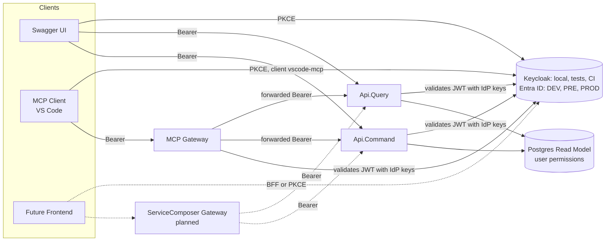
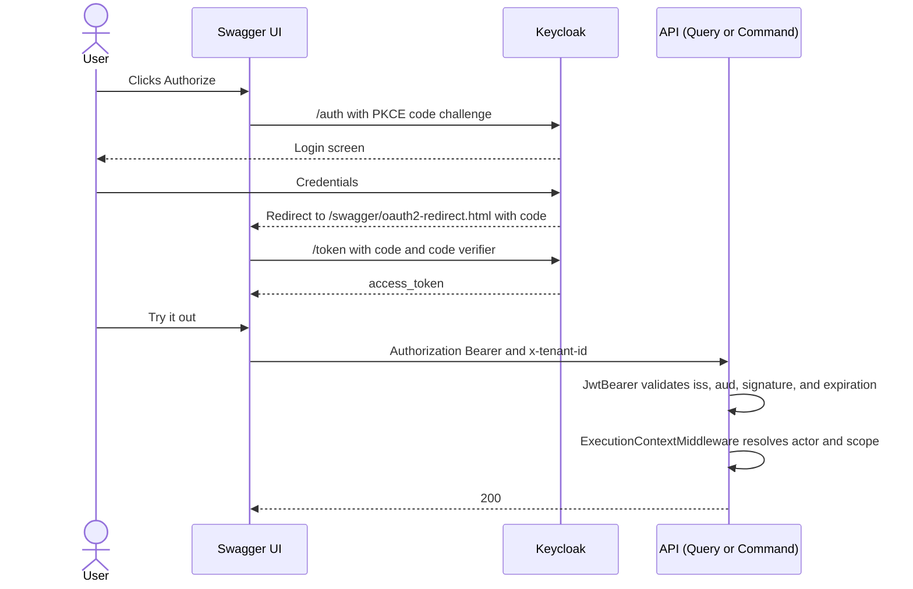
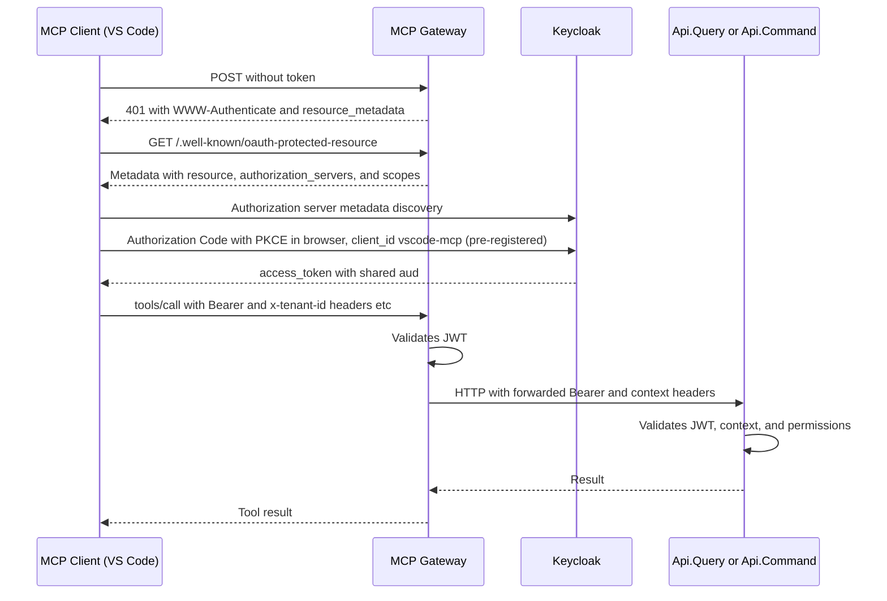

# Authentication in Shared Kernel: Design and Implementation

> Quick and detailed guide to understand how each request is authenticated and contextualized in the system:
> APIs (Query and Command), Swagger UI, MCP Gateway, ServiceComposer gateway (planned), tests, Keycloak, and Entra ID.

**Status of each component**

| Component | Status |
|---|---|
| Api.Query and Api.Command with JWT (Keycloak locally, Entra ID configured for cloud) | Implemented |
| Swagger UI with Authorization Code + PKCE | Implemented |
| Actor and context resolution (`ExecutionContextMiddleware`) | Implemented |
| Shared authentication code in `SharedKernel.Presentation.HttpRestfulApi` | Implemented |
| Functional tests (fake auth) and System Tests (real Keycloak) | Implemented |
| MCP Gateway with OAuth (resource server) | Implemented and working with VS Code (pre-registered client `vscode-mcp`) |
| Entra ID in DEV/PRE/PROD | Configuration with placeholders only, **untested** |
| ServiceComposer Gateway in front of the APIs | Planned |

## Table of Contents

1. [Purpose and Scope](#1-purpose-and-scope)
2. [Key Concepts](#2-key-concepts)
3. [Architecture and Division of Responsibilities](#3-architecture-and-division-of-responsibilities)
4. [How It Works](#4-how-it-works)
5. [Testing](#5-testing)
6. [Design Decisions](#6-design-decisions)
7. [Mental Model](#7-mental-model)
8. [Benefits](#8-benefits)
9. [Edge Cases and Troubleshooting](#9-edge-cases-and-troubleshooting)
10. [Pending Items and Open Risks](#10-pending-items-and-open-risks)
11. [Quick Reference](#11-quick-reference)

---

## 1. Purpose and Scope

**Objective:** Ensure every request to the APIs (and MCP tools) arrives with the identity of a real user, validated
with a JWT issued by an OIDC provider, and convert that identity into an execution context (actor, tenant,
partition, domain) upon which business authorization is enforced.

**Requirements that guided the design**

- **Two providers, single codebase**: Keycloak locally, integration tests, functional tests, and pipelines; Entra ID in
  cloud environments (DEV → PRE → PROD). The code must remain provider-agnostic.
- **Clean Architecture**: Domain and Application layers know nothing about claims or JWTs. Everything related to authentication
  lives in the presentation layer; the rest only sees an `ExecutionContext`.
- **Actual authorization resides in each application** (permissions per tenant/partition/domain). The gateway and MCP only
  authenticate and propagate.
- **No configuration duplication** across Api.Query, Api.Command, MCP Gateway, and future bounded contexts.
- **Reproducibility with Aspire**: Pressing `F5` spins up pre-configured Keycloak (imported realm) and the APIs receive their
  configuration from the AppHost.

**Out of scope for this document:** domain authorization (`User` roles/permissions), Redis cache, and the internal
design of the ServiceComposer gateway.

---

## 2. Key Concepts

| Concept | What it is in this system |
|---|---|
| **OIDC / OAuth2** | Standard used by both Keycloak and Entra ID. That is why a single `AddJwtBearer` suffices for both. |
| **JWT (access token)** | Signed token validated by the API: signature, `iss`, `aud`, and expiration. |
| **Authority** | Issuer URL (Keycloak realm or Entra tenant). Metadata and signing keys are downloaded from here. |
| **Issuer (`iss`)** | Who issued the token. Must match the Authority **exactly** (watch out for `localhost` vs `127.0.0.1`). |
| **Audience (`aud`)** | Intended recipient of the token. Decision: a shared audience across the entire backend (`jordiaragonzaragoza.cinema.api`). |
| **`sub` vs `oid`** | Claim containing the user ID. Keycloak uses `sub`. In Entra, `sub` differs per user **and per application** (pairwise), so the stable one is `oid`. |
| **`MapInboundClaims = false`** | Prevents .NET from renaming claims (e.g., `sub` to a long URI). Claims retain their original names. |
| **Authorization Code + PKCE** | Interactive flow: used by Swagger UI and MCP clients. The token is obtained in the browser without a client secret. |
| **Password grant** | Non-interactive flow, **for development and System Tests only** (client with *Direct access grants*). |
| **Actor** | Who executes the action: `User` (valid JWT) or `External` (`[AllowAnonymous]` endpoint, identified by IP). |
| **Execution context** | Actor + `x-tenant-id` + `x-partition-id` + `x-domain-id` + correlation. Built by `ExecutionContextMiddleware`. |
| **Token pass-through** | The gateway/MCP forwards the exact same token it received to the downstream APIs. |
| **Protected Resource Metadata (RFC 9728)** | MCP Gateway document telling MCP clients which authorization server issues the tokens it accepts. |
| **DCR (Dynamic Client Registration)** | Mechanism by which an MCP client registers itself with the authorization server. **Not used locally**: VS Code fails to do this with Keycloak, so the pre-registered `vscode-mcp` client is used instead. |

---

## 3. Architecture and Division of Responsibilities



### Projects and Their Contents

| Project | Responsibility | Knows about Keycloak/Entra |
|---|---|---|
| `JordiAragonZaragoza.SharedKernel.Presentation.HttpRestfulApi` | Agnostic JWT Bearer, Swagger, versioning, CORS, pipeline, `ExecutionContextMiddleware`, user claim resolver | **No** |
| **AppHost** (`JordiAragonZaragoza.Cinema`) | Spins up Keycloak, imports the realm, and **injects auth configuration** into each API/gateway | **Yes** (single place) |
| Api.Query / Api.Command | Register auth + versioning + Swagger with 2 calls to SharedKernel | No |
| MCP Gateway | Validates JWT, publishes OAuth metadata, forwards identity to APIs | No |


---

## 4. How It Works

### 4.1 A Request to an API, Step by Step

`UseWebApplicationConfigurations` pipeline (order matters):

1. Developer exception page (Development) or HSTS.
2. `ExceptionMiddleware`.
3. `UseSerilogRequestLogging`.
4. `UseHttpsRedirection`.
5. CORS (only if `ApiOptions.EnableCors = true`).
6. **`UseAuthentication`**: validates the JWT (signature, `iss`, `aud`, expiration). If valid, populates `HttpContext.User`.
7. **`UseAuthorization`**: enforces `[Authorize]`. Base controllers include it; without a valid token, it returns `401`.
8. **`ExecutionContextMiddleware`**: builds the context (details below).
9. Swagger and Swagger UI (Development only).
10. `MapControllers`.

**`ExecutionContextMiddleware`**

| Situation | Outcome |
|---|---|
| Infrastructure endpoint (health, etc.) | Passes through without context |
| Authenticated user with valid ID claim (GUID) | `User` actor with that ID |
| Authenticated user **without** valid ID claim | `401` (`unauthorized`) |
| Unauthenticated and `[AllowAnonymous]` endpoint | `External` actor, identified by IP |
| Unauthenticated and protected endpoint | `401` |
| `User` actor without `x-tenant-id` | `400` (`invalid_tenant`) |
| `External` actor without tenant | Uses the system tenant (`SystemTenantId`) |
| `User` actor without access to scope (tenant/partition/domain) | `403` (`forbidden`), via `ValidateScopeAsync` |
| Everything valid | Context is set, `x-correlation-id` is added to the response, and cleared upon completion |

**Three gates in order:**

1. Who are you? A valid JWT (authentication, `401`).
2. In what context are you acting and are you allowed in? Tenant, partition, and domain validated against permissions (`400` and `403`).
3. What can you do there? Domain authorization in handlers and aggregates (out of scope for this document).

`ValidateScopeAsync` queries the **permissions read model** (`UserAuthorizationReadModel`) in Postgres, built by the
Projector from the event store. This is why Api.Command also requires access to the read model database.

**Context headers**

| Header | Required | Usage |
|---|---|---|
| `x-tenant-id` | Yes (`User` actors) | Tenant being acted upon |
| `x-partition-id` | No | Data partition |
| `x-domain-id` | No | Domain or context (for example, a cinema) |
| `x-correlation-id` | No | If missing, it is generated and returned in the response |
| `x-causation-id` | No | Links to the event that originated the request. Internal use: MCP Gateway does **not** forward it |

### 4.2 Swagger UI (Authorization Code + PKCE)



- Mounted only in **Development** (`UseSwagger`/`UseSwaggerUI`).
- Two **alternative** security schemes (OR, two separate `AddSecurityRequirement` calls):
  `Bearer` (manually pasting the token, `Http` + `bearer`) and `oauth2` (login with Keycloak).
- `oauth2` is only registered if `Swagger:OAuth2` has `AuthorizationUrl` and `TokenUrl` (`IsConfigured`).
- The same `swagger-ui` client serves all APIs; what expands per API are redirect URIs and *Web origins*.
- The `AddRequiredHeadersOperationFilter` documents context headers across all operations.
- Browser cross-origin requests to Keycloak (token exchange) are handled via the client's *Web origins*, **not** via API
  CORS.

### 4.3 Environment Configuration: What Changes Between Keycloak and Entra

The entire difference between providers is **configuration**, not code:

| Key | Local, tests, and CI (Keycloak) | Cloud (Entra ID) |
|---|---|---|
| `Authentication:Schemes:Bearer:Authority` | Injected by AppHost: `http://localhost:8080/realms/jordiaragonzaragoza.cinema` (Keycloak over HTTP, see 4.5) | `https://login.microsoftonline.com/<tenant-id>/v2.0` |
| `Authentication:Schemes:Bearer:Audience` | `jordiaragonzaragoza.cinema.api` (AppHost) | API Client ID (GUID) |
| `Authentication:Claims:UserIdClaimType` | `sub` (AppHost) | `oid` (default in `appsettings.json`) |
| `Swagger:OAuth2:AuthorizationUrl` and `TokenUrl` | `.../protocol/openid-connect/auth` and `/token` (AppHost) | Entra `oauth2/v2.0` endpoints, or omitted |
| `Swagger:OAuth2:ClientId` and `Scopes` | `swagger-ui`, `openid`, and `profile` (default) | Entra client and scopes |
| `RequireHttpsMetadata` | `false` in Development | `true` (default outside Development) |

**How local configuration arrives.** The AppHost defines `WithKeycloakAuthentication(keycloak)`, which waits for Keycloak and
injects environment variables `Authentication__Schemes__Bearer__Authority`, `__Audience`,
`Authentication__Claims__UserIdClaimType=sub`, and `Swagger__OAuth2__AuthorizationUrl`/`__TokenUrl`. Environment variables
take precedence over JSON, so `appsettings.json` retains "production" values.

**Placeholders.** Each host's `appsettings.json` contains placeholders (`<tenant-id>`, `<API-client-id>`...). Any value
containing `<` is treated as **unconfigured** (`IsConfigured`). Outside Development, `ValidateOnStart` causes the
application to fail fast at startup with a clear error message rather than returning `401` on every request. Validation is
skipped in Development so functional tests (fake authentication) do not require an Authority.

**`AddSharedKernelJwtBearerAuthentication`** (single validation point)

- `AddJwtBearer` with `Authority` and `Audience` read from `Authentication:Schemes:Bearer`.
- `MapInboundClaims = false`.
- `RequireHttpsMetadata` configurable, defaulting to `!IsDevelopment()`.
- Kept separate from `AddSharedKernelHttpRestfulApi` so a gateway can validate JWTs without controllers or versioning.

### 4.4 User ID Resolution (`sub` vs `oid`)

- The middleware does not read a hardcoded claim: it uses `IUserIdentifierResolver`, which reads the claim name from
  `Authentication:Claims:UserIdClaimType` (`IdentityClaimsOptions`).
- **No fallback** from `oid` to `sub` (or vice versa). In Entra, `sub` is pairwise per application: silently falling back to `sub`
  would create a distinct actor for the same user. Each environment explicitly declares its claim.
- The value must be a **GUID**; otherwise, the actor fails to resolve and the response is `401`.

### 4.5 Keycloak

The `jordiaragonzaragoza.cinema` realm is imported via `WithRealmImport("../../containers/keycloak")` from the file
`jordiaragonzaragoza_cinema-realm.json`, with development users manually defined in the `users` section.

| Element | Configuration |
|---|---|
| Client `swagger-ui` | Public, Standard flow, PKCE `S256`, redirect URIs `https://localhost:PORT/swagger/oauth2-redirect.html` per API, *Web origins*, audience mapper |
| Client `cinema-system-tests` | Public, **Direct access grants** (password grant), no Standard flow, audience mapper. Development only |
| Client `vscode-mcp` | Public, Standard flow, PKCE `S256`, redirect URIs `http://127.0.0.1:33418` (with and without trailing `/`) and `https://vscode.dev/redirect`, *Web origins* `https://vscode.dev`. This is the client VS Code prompts for once when connecting to MCP |
| Client scope `cinema-api-audience` | `oidc-audience-mapper` (`included.custom.audience` = shared audience, access token only). Added to `defaultDefaultClientScopes` so clients without their own scopes inherit it |
| User `jordiaragonzaragoza` | `id` = `6bb46b99-e3d1-459b-9e1e-f8d8d7619864` (matches `SeedData.ExampleUserWithAdminRole`, aligning `sub` with the seeded user), `firstName`, `lastName`, and `email` populated, `emailVerified`, no `requiredActions`, non-temporary password |

Points worth remembering:

- **`sub`** is provided by the `basic` client scope, which is *default* in Keycloak 26.
- **Keycloak 26 and user profile**: without `firstName`, `lastName`, and `email`, the password grant fails with
  `Account is not fully set up`.
- **Audience**: Keycloak does not include `aud` by default. Without the mapper, the API returns `401`.
- **Import only occurs if the realm does not already exist.** A persistent Keycloak (`WithDataVolume`) will **not** pick up
  subsequent changes to the JSON: you must delete the volume or apply changes manually. In System Tests, a fresh container
  is spun up per run.
- Password grant is deprecated in OAuth 2.1: acceptable solely for test users in a development realm.

**Keycloak is served over HTTP locally.** By default, Aspire also exposes Keycloak over HTTPS using the development
certificate. Consequently, token and metadata `iss` became `https://localhost:8080/...`, differing from the `http://`
Authority injected by the AppHost: the gateway could neither validate the issuer nor download metadata, rejecting
**all** tokens with `401`, even after a successful login. Solution: serve HTTP only.

```csharp
#pragma warning disable ASPIRECERTIFICATES001 // Experimental Aspire API
var keycloak = builder.AddKeycloak(Constants.Keycloak, 8080)
                      .WithoutHttpsCertificate()
                      .WithOtlpExporter()
                      .WithImageTag(Constants.KeycloakImageTag)
                      .WithRealmImport("../../containers/keycloak");
#pragma warning restore ASPIRECERTIFICATES001
```

Rule: the Authority scheme, the token `iss`, and the endpoint used by System Tests (`http`) must match.
After changing this, cached tokens and providers in clients must be cleared (in VS Code, *Authentication: Remove
Dynamic Authentication Providers*).

### 4.6 Entra ID (Configured, Untested)

Expected configuration per environment (these are not secrets; they can live in `appsettings`, environment variables, or
service configuration):

```json
"Authentication": {
  "Schemes": { "Bearer": {
    "Authority": "https://login.microsoftonline.com/<tenant-id>/v2.0",
    "Audience": "<API-client-id>"
  } },
  "Claims": { "UserIdClaimType": "oid" }
}
```

Known pitfalls:

- **Token version**: by default, Entra issues **v1** tokens to APIs (`iss` from `sts.windows.net`, `aud` formatted as
  `api://...`). Version 2 must be enforced in the API app registration manifest
  (`accessTokenAcceptedVersion` or `api.requestedAccessTokenVersion`, depending on manifest schema). Otherwise, validation
  fails due to issuer or audience mismatch.
- **Audience v2** = client ID (GUID) of the API.
- **Application tokens** (client credentials): request `api://<client-id>/.default`, contain `roles` instead of `scp`, and their
  `oid` belongs to the *service principal*. Currently, such a token would resolve as `ActorType.User`; if supported in the future,
  they must be distinguished (via the `idtyp` claim).
- **Swagger in cloud** (if enabled): the client must be registered as a *Single-page application* (browser PKCE) and
  scopes will be `api://<client-id>/<scope>`.
- **MCP**: Entra does not support dynamic client registration. A pre-registered client will be required.

### 4.7 CORS

- **Disabled on the APIs** (`ApiOptions.EnableCors = false`). CORS is enforced by browsers, not servers, and APIs are
  only called server-to-server by the gateway and MCP. Swagger UI is served from the same origin as the API.
- The policy lives in `CorsExtensions` (`AddSharedKernelCors` and `UseSharedKernelCors`) and is **reusable by the gateway**
  once a frontend exists.
- Origins: `Cors:AllowedOrigins` array (e.g., `Cors__AllowedOrigins__0`).
- **Fail-closed**: outside Development, starting without configured origins throws an exception at startup.
- **Development**: without configuration, only loopback origins (`localhost`, `127.0.0.1`, `[::1]`) are accepted via an
  explicit predicate. This replaced `AllowAnyOrigin()` (Sonar rule S5122).
- **No `AllowCredentials`**: tokens travel in the `Authorization` header, not cookies. It should only be added—with explicit
  origins—if a cookie-based BFF is introduced.
- Exposes `x-correlation-id`, `api-supported-versions`, and `api-deprecated-versions` (browsers block reading custom headers
  unless explicitly exposed), and sets `SetPreflightMaxAge` to 1 hour (`x-*` headers trigger preflight requests).

### 4.8 MCP Gateway

The MCP Gateway acts as an **OAuth resource server** per the MCP specification.



**Components**

- `AddMcpGatewayAuthentication`: reuses `AddSharedKernelJwtBearerAuthentication` and registers the MCP scheme
  (`AddMcp`) with `ProtectedResourceMetadata`: `Resource` = `Mcp:ResourceUrl`, `AuthorizationServers` = the Authority,
  `ScopesSupported` = `openid`, `profile`. Default authentication scheme: JwtBearer; default *challenge* scheme: MCP.
- Pipeline: `UseAuthentication` and `UseAuthorization` **before** `MapMcp().RequireAuthorization()`. The MCP scheme
  serves the metadata endpoint and appends `resource_metadata` to `401` responses.
- `WithHttpTransport(options => options.Stateless = true)`: no in-memory session state, so multiple replicas (AKS) do not
  require session affinity. It also ensures `IHttpContextAccessor` always has an `HttpContext`.
- `AuthorizationDelegatingHandler` (on typed Command and Query clients) copies the following headers to outgoing API requests:
  `Authorization`, `x-tenant-id`, `x-partition-id`, `x-domain-id`, and `x-correlation-id`. Allow-list behavior: `x-causation-id` is
  not forwarded.
- `ExceptionHandlingFilters`: translates API `401` or `403` responses into an `McpException` with a model-friendly error message
  (permissions, scope headers) rather than the generic `EnsureSuccessStatusCode` exception.
- **Pre-registered client, no DCR.** VS Code cannot dynamically register itself with Keycloak. Upon connecting, it displays a
  prompt asking for a client ID: enter `vscode-mcp` (public realm client, see 4.5) once. Entering another ID
  (such as the audience) causes Keycloak to return `Invalid parameter: redirect_uri`.
- The token must include `aud`: either via the `cinema-api-audience` scope (realm default) or a custom client mapper.
- The "Sign-in successful! Returning to Visual Studio Code..." page is served by VS Code itself (loopback
  `127.0.0.1:33418`): it indicates login and redirect succeeded, **not** that the gateway accepted the token.
- **Misleading VS Code fallback.** If the gateway returns `401` after login, VS Code retries bypassing metadata discovery
  and treats the gateway itself as an authorization server: it opens `http://localhost:5003/authorize` (404) and reports that
  the server "does not support dynamic client registration". The symptom points to the wrong culprit: the actual root cause was
  the gateway rejecting the token (`https` issuer mismatch, see 4.5).
- Diagnostics without VS Code (curl): metadata `GET /.well-known/oauth-protected-resource` (200), `POST /` without token (401 with
  `resource_metadata`), and `POST /` with a real token (200).
- `.mcp.json` (`mcpServers` format), with the URL lacking a trailing slash (matching `Mcp:ResourceUrl`) and context headers:

```json
{
  "mcpServers": {
    "cinema-reservation": {
      "type": "http",
      "url": "http://localhost:5003",
      "tools": ["*"],
      "headers": {
        "x-tenant-id": "667196fc-0e17-43f9-990d-7dc2175e6162",
        "x-partition-id": "05cbd871-da4e-447b-9d62-89438df8c4a8",
        "x-domain-id": "497cd8f1-620c-426f-992d-7012147f6e7c"
      }
    }
  }
}
```

Asserting the tenant on the client poses no security risk: downstream APIs validate whether the user has access to that scope.

### 4.9 ServiceComposer Gateway (Planned)

- Validates the token **at the edge** and forwards it to downstream APIs (pass-through) using a shared audience.
- A single propagation `DelegatingHandler` (token and context headers) prevents every *composition handler* from having
  to manually forward headers. Generates `x-correlation-id` if omitted by the client.
- APIs **must not be reachable outside the gateway** (network isolation): this is the prerequisite that keeps a shared
  audience secure.
- Will reuse `AddSharedKernelJwtBearerAuthentication` and `CorsExtensions` (CORS will be enforced at the gateway once a
  frontend exists). For an SPA, a BFF pattern (`HttpOnly` cookie with token attached on internal calls) will be evaluated.

---

## 5. Testing

| Level | Authentication | Why |
|---|---|---|
| **Functional** (`WebApplicationFactory`, Testcontainers) | **Fake**: `AuthHandler` | Tests our own pipeline rather than Keycloak's JWT issuance. Fast and deterministic |
| **System Tests** (Aspire Testing, full stack) | **Real Keycloak** | Mirrors real user flow: real JWT, issuer, audience, `sub`, and permissions |

### 5.1 Functional Tests

- `AuthHandler` (`Test` scheme) only authenticates requests carrying `Authorization: Test {userId}`; all others remain
  unauthenticated, allowing `401` scenarios to be tested as well.
- The user ID claim is emitted using the **configured claim name** (`IOptions<IdentityClaimsOptions>`), without hardcoding
  `sub`. Tests run with "production" settings (`oid`).
- In `CustomWebApplicationFactory`, `ConfigureTestServices` registers `AuthHandler` and sets it as the default scheme;
  JWT Bearer remains registered in DI but does not execute.
- `FunctionalTestsFixture.CreateClient(authenticated)` attaches the authorization header and context headers.
  - **Api.Query**: `x-tenant-id` = `SystemConstants.SystemTenantId`.
  - **Api.Command**: `x-tenant-id`, `x-partition-id`, and `x-domain-id` from seed data (`ExampleTenant`, `ExamplePartition`,
    `ExampleCinema`) and user `ExampleUserWithAdminRole`.
- **Command requires Postgres** in addition to KurrentDB: `ValidateScopeAsync` queries the permissions read model. The fixture
  spins it up (Testcontainers) and seeds `UsersAuthorizations` without an external `ScopeInfo`, scoping permissions to the
  seeded tenant, partition, and domain.

### 5.2 System Tests

- `SystemTestsFixture` boots the AppHost (`IsTesting=true`), **waits until Keycloak is healthy**, and requests a token via
  `KeycloakTokenClient` (password grant, `cinema-system-tests` client, `jordiaragonzaragoza` user).
- `KeycloakTokenClient` retries on `404` (realm not yet imported), `5xx`, and connection errors; fails immediately on
  other `4xx` responses (misconfiguration), outputting the response body.
- Command and Query `HttpClient` instances are pre-configured with `Authorization: Bearer` and context headers as default headers.
- Tokens are requested from `localhost:8080`, matching the Authority host configured on the APIs; otherwise `iss` would not match.
- Keycloak runs over HTTP (`.WithoutHttpsCertificate()`, see 4.5), matching the APIs' Authority: HTTPS would cause an `iss` mismatch.
- **Realm not imported** (`Realm does not exist`): the likeliest culprit was `--tmpfs` mounted over `/opt/keycloak/data` in test
  mode, masking the `/opt/keycloak/data/import` bind mount. Removing `tmpfs` specifically for Keycloak was recommended (with
  `ContainerLifetime.Session` and no persistent volume, state is already ephemeral).

---

## 6. Design Decisions

| # | Decision | Rejected Alternatives | Rationale | Consequence |
|---|---|---|---|---|
| 1 | **Single configuration-driven `AddJwtBearer`** for Keycloak and Entra | Separate class per provider, Aspire's `AddKeycloakJwtBearer` | Both implement OIDC. Single validation path across all environments | Switching providers is purely a config change. `Aspire.Keycloak.Authentication` removed |
| 2 | **Explicit user claim per environment** (`UserIdClaimType`) | Fallback from `oid` to `sub`; using `sub` everywhere | `sub` is pairwise in Entra; fallback would create duplicate actors | Must configure the right claim per environment. No implicit magic |
| 3 | **`MapInboundClaims = false`** | Keeping default claim mapping and querying long URIs | Claims keep the exact names visible in jwt.io | Anything relying on `User.Identity.Name` requires configuring `NameClaimType` |
| 5 | **Swagger endpoints and scopes via configuration** (`Swagger:OAuth2`) | Constructing Keycloak URLs in code | Keycloak and Entra URL structures differ | AppHost injects them locally; cloud environments set them in `appsettings` or omit them |
| 6 | **Single `swagger-ui` client for all APIs** | One client per API | Client = *who* requests the token; audience = *which API* it targets | Each new API simply appends its redirect URIs and web origins |
| 7 | **Shared audience** (`jordiaragonzaragoza.cinema.api`), configurable per API | One audience per bounded context | Single trust boundary, single team, trivial cross-context calls | A Cinema token is valid across all APIs. Mitigated via network isolation. Payments can be isolated later |
| 8 | **Token pass-through** (gateway and MCP) | Token exchange / On-Behalf-Of | Simplicity and alignment with the shared audience | Deviation from MCP security guidelines (see risks). Isolated in a single `DelegatingHandler` |
| 9 | **Actual authorization inside each application** (context + domain) | Enforcing authorization at the gateway | Gateway must remain unaware of business rules | Each API validates tenant/scope even if the client asserts the headers |
| 10 | **CORS disabled on APIs**, reusable fail-closed policy | Permissive CORS with credentials | Server-to-server traffic; no `AllowCredentials` since Bearer tokens are used | CORS is enabled on the gateway once a frontend is introduced |
| 11 | **Fail at startup** if Authority or Audience is missing (outside Development), treating placeholders as unconfigured | Failing on the first incoming request | Catch misconfigurations during deployment | Validation skipped in Development to support functional tests |
| 12 | **Functional tests with fake auth; System Tests with real Keycloak** | Real Keycloak across all test suites | Speed and determinism vs. high fidelity | Entra-specific behavior must be verified via smoke tests in PRE |
| 13 | **Password grant restricted to development clients** | Automating browser-based login | Non-interactive way to obtain a structurally identical JWT | Also imported during F5: never export this realm to higher environments |
| 14 | **Stateless MCP** | In-memory sessions | Horizontal scaling in AKS and guaranteed `HttpContext` availability | Tools cannot rely on stateful session features |
| 16 | **Keycloak over HTTP locally** (`.WithoutHttpsCertificate()`) | HTTPS using Aspire's dev certificate | `https` issuer mismatched the `http` Authority, causing the gateway to reject all tokens | Uses experimental Aspire API (`ASPIRECERTIFICATES001`). Local, tests, and CI only; Entra always uses HTTPS |
| 17 | **Pre-registered `vscode-mcp` client** instead of DCR | Dynamic client registration (anonymous *Trusted Hosts* policy) | VS Code fails DCR against Keycloak; a pre-registered client is deterministic and lives in the realm | VS Code prompts for the client ID once. Entra also lacks DCR, keeping the model consistent |

---

## 7. Mental Model

1. **The IdP is an interchangeable token provider.** To the codebase, Keycloak and Entra are identical: an Authority, an
   Audience, and a claim name. Everything else is environment-injected configuration (AppHost locally, `appsettings`
   or environment variables in cloud).
2. **Three gates**: identity (JWT), context (tenant and scope), and domain permissions. Each fails with its own status code:
   `401`, `400` or `403`, and domain errors.
3. **The token belongs to the person, not the service.** Gateway, MCP, and APIs act on behalf of the user by forwarding their token.
   Background workers and machine-to-machine callers would use *client credentials* (one client per **caller**, not callee).
4. **Client vs. audience**: the client is *who* asks; the audience is *for whom*. Hence one client per *tool*
   (Swagger, System Tests) and one audience per *backend*.
5. **AppHost is the "constitution" of the local environment**: it defines Keycloak and communicates it to each project. SharedKernel
   never imports anything Keycloak-specific.
6. **Tests choose their level of realism**: fake auth to verify the pipeline, real Keycloak to verify the contract.

---

## 8. Benefits

- **Single validation path** across local, CI, and production: System Tests with Keycloak exercise the exact code path that
  runs against Entra.
- **Switching or adding providers requires zero code changes**: configuration only.
- **Zero duplication**: Query, Command, MCP, and future bounded contexts consume the exact same extensions.
- **Clean Domain and Application layers**: no claims or JWT concepts leak outside presentation.
- **Early, actionable errors**: invalid configuration fails at startup; HTTP responses cleanly distinguish `401`, `400`, and `403`.
- **Sensible security defaults**: no CORS on APIs, no `AllowCredentials`, fail-closed CORS, pinned `MapInboundClaims`,
  and allow-listed forwarded headers.
- **Reproducible F5 experience**: Keycloak boots with imported realm and users, and environment variables are injected by AppHost.
- **Scalable**: stateless MCP with no session affinity requirements.
- **Ready to evolve**: supports future adoption of token exchange (Payments, MCP), BFF, or per-context audiences without redesign.

---

## 9. Edge Cases and Troubleshooting

| Symptom | Probable Cause | Resolution |
|---|---|---|
| `401` with a token that looks valid on jwt.io | Missing `aud`: client or scope lacks the audience mapper | Add the mapper (or assign the *default* client scope) |
| `401` with mismatched `iss` | Token requested via `127.0.0.1` or another host differing from Authority | Consistently use `localhost:8080` everywhere |
| `401` and `sub`/`oid` claim is missing | `UserIdClaimType` mismatches the token (e.g., `oid` with Keycloak) or `MapInboundClaims = false` is missing | Align the configured claim name with the provider |
| `401` even though the claim exists | Claim value is not a valid GUID | User IDs must be valid GUIDs |
| `400 invalid_tenant` | Missing `x-tenant-id` header | Include the header (Swagger prompts for it; MCP reads it from `mcp.json`) |
| `403 forbidden` | User lacks permissions for that tenant, partition, or domain; or permission projection hasn't caught up yet (eventual consistency) | Verify seed data / user `sub`; in System Tests, wait for permission projection |
| API fails at startup in cloud | Missing Authority or Audience, or still contains `<placeholder>` | Supply values via environment variables |
| First authenticated request fails in Development without AppHost | Authority still has placeholder: startup validation was skipped | Launch via AppHost |
| `Account is not fully set up` when requesting a token | Keycloak user missing `firstName`, `lastName`, or `email`, or has pending required actions | Complete user profile and clear `requiredActions` |
| `Realm does not exist` | Realm failed to import (stale persistent volume or bind mount hidden by `tmpfs`) | Delete the volume or remove `tmpfs` from Keycloak |
| Changes to realm JSON don't appear on F5 | Import is skipped if the realm already exists in the persistent volume | Delete the volume or apply changes manually |
| Token expires mid-run during System Tests | Default 5-minute token lifespan | Increase `accessTokenLifespan` in the dev realm or refresh via a `DelegatingHandler` |
| Swagger: `Invalid parameter: redirect_uri` | Exact redirect URI mismatch (scheme or port) | Register each API's exact redirect URI |
| Swagger: login succeeds but token exchange fails | Client *Web origins* misconfigured | Add the API's origin |
| Swagger sends token to anonymous endpoints | Security requirement is registered globally | Harmless; can be refined with an `IOperationFilter` if needed |
| MCP: `401` without `resource_metadata` | `UseAuthentication` is not placed before `MapMcp`, or `RequireAuthorization` is missing | Verify middleware pipeline order |
| MCP: client cannot discover the authorization server | `Mcp:ResourceUrl` mismatches the client's target URL, or Authority is unreachable from the browser | Align URLs |
| MCP: VS Code prompts for a client ID | Dynamic client registration is not used with Keycloak | Enter `vscode-mcp`, the realm's pre-registered client |
| MCP: Keycloak returns `Invalid parameter: redirect_uri` | Wrong client ID entered (e.g., the audience) or incomplete redirect URIs | Use `vscode-mcp`; redirect URIs must include `http://127.0.0.1:33418` (with and without `/`) and `https://vscode.dev/redirect` |
| MCP: login succeeds ("Sign-in successful") but VS Code opens `localhost:5003/authorize` (404) and mentions DCR | Gateway rejected the token (e.g., `https` issuer vs `http` Authority) and VS Code fell back | Verify with curl (metadata 200, unauthenticated POST 401 with `resource_metadata`, authenticated POST 200) and inspect JwtBearer logs. Ensure Keycloak serves HTTP |
| Tokens or metadata have `iss` `https://localhost:8080/...` | Keycloak is serving HTTPS with the dev certificate | Add `.WithoutHttpsCertificate()` in AppHost and clear cached tokens/providers |
| VS Code keeps using stale credentials after config changes | Cached dynamic authentication provider (old issuer or client) | Run *Authentication: Remove Dynamic Authentication Providers* and restart the MCP server |
| MCP: API receives `401` from tool calls | Null `HttpContext` (missing `Stateless`) or handler not attached to typed client | Keep `Stateless = true` and `AddHttpMessageHandler<AuthorizationDelegatingHandler>()` |
| Entra application token treated as a user | Resolver does not inspect `idtyp` | Update resolver if application tokens are eventually supported |
| Entra returns `401` due to issuer or audience | Token version is v1 | Enforce v2 tokens in the API's app registration manifest |
| CORS fails with empty `Cors:AllowedOrigins` in cloud | Fail-closed startup check | Configure allowed origins list (only if `EnableCors` is true) |

---

## 10. Pending Items and Open Risks

| Topic | Details |
|---|---|
| **Token pass-through in MCP** | MCP security guidelines discourage forwarding received tokens directly to downstream APIs (*confused deputy* risk). Accepted for now due to the shared audience and single trust boundary. Migration to token exchange (Keycloak) or On-Behalf-Of (Entra) is isolated inside `AuthorizationDelegatingHandler` |
| **Untested Entra ID** | Local and CI environments do not cover Entra token nuances (v1 vs v2, `oid` vs `sub`, `scp` vs `scope`). Recommended: run a smoke test in PRE against Entra performing an authenticated call and verifying actor resolution |
| **MCP with Entra** | Entra does not support DCR; will require a pre-registered client and validation of the MCP client flow |
| **Other MCP clients** | Validated with VS Code. Browser-based clients (such as MCP Inspector) may require gateway CORS and dedicated realm clients. `ProtectedResourceMetadata` (strings) and `Stateless` types depend on the SDK version |
| **Realm hygiene** | (1) `jordiaragonzaragoza.cinema.api` client: public, with wildcard `/*` redirect URIs and web origins and no real usage; remove alongside the `jordiaragonzaragoza.cinema.api.all` scope. (2) Audience is defined in five places (per-client mappers and `cinema-api-audience` scope): consolidate into the single scope assigned to `swagger-ui`, `vscode-mcp`, and `cinema-system-tests`. (3) `swagger-ui`: `https://localhost:5001/...` redirect URI mismatches `http://localhost:5001` web origin; cross-check against `launchSettings`. (4) Relaxed unused anonymous DCR policy (`github.com` and other trusted hosts, `offline_access`, `host-sending-registration-request-must-match=false`): reset to defaults. (5) Plaintext user password in JSON: ensure it remains disposable. (6) File is a ~76 KB full export (including default clients, flows, and key providers): consider trimming to custom definitions only |
| **Eventual consistency of permissions** | `ValidateScopeAsync` queries a Projector-built read model: transient `403` responses may occur immediately after seeding data |
| **ServiceComposer Gateway** | Not yet built: propagation handler, edge validation, CORS, and network isolation for APIs |
| **Per-bounded-context audiences** | If a context (e.g., Payments) requires strict isolation, migrate to a dedicated audience and token exchange; audience is already configurable per API |
| **Application tokens (M2M)** | Currently resolve as `User`; define a dedicated service actor if M2M tokens are adopted |
| **Cache (out of scope)** | `CacheService.GetAsync` never returns a cache hit, leaving the cache write-only; investigation deferred |

---

## 11. Quick Reference

### Configuration Keys

| Key | Used By | Notes |
|---|---|---|
| `Authentication:Schemes:Bearer:Authority` | All APIs and MCP | Required outside Development |
| `Authentication:Schemes:Bearer:Audience` | All APIs and MCP | Required outside Development |
| `Authentication:Schemes:Bearer:RequireHttpsMetadata` | JwtBearer | Defaults to `!IsDevelopment()` |
| `Authentication:Claims:UserIdClaimType` | Api.Query and Api.Command | `oid` (Entra) or `sub` (Keycloak) |
| `Swagger:OAuth2:AuthorizationUrl`, `TokenUrl`, `ClientId`, `Scopes` | Swagger UI | If URLs are omitted, only manual Bearer scheme is available |
| `Cors:AllowedOrigins` (array) | Any host with CORS enabled | Required only when `EnableCors` is true |
| `Mcp:ResourceUrl` | MCP Gateway | Must match the URL configured in the client |

### Constants (Cinema.SharedKernel)

`Keycloak` = `"Keycloak"` · `KeycloakRealm` = `"jordiaragonzaragoza.cinema"` · `KeycloakAudience` =
`"jordiaragonzaragoza.cinema.api"` · `KeycloakImageTag` = `"26.8"`

### Component Wiring

| Component | Method |
|---|---|
| API (services) | `AddSharedKernelJwtBearerAuthentication(...)` and `AddSharedKernelHttpRestfulApi(..., new ApiOptions { Title = ... })` |
| API (pipeline) | `UseSharedKernelHttpRestfulApi()` |
| AppHost | `.WithKeycloakAuthentication(keycloak)` on each project |
| MCP Gateway | `AddMcpGatewayAuthentication(...)`, `MapMcp().RequireAuthorization()`, and `AuthorizationDelegatingHandler` |
| Functional Tests | `AuthHandler` + `CreateClient(authenticated)` |
| System Tests | `KeycloakTokenClient` + `SystemTestUser` |

### Useful Seed Data for Testing

| Item | Value |
|---|---|
| Admin user (`sub` in Keycloak) | `6bb46b99-e3d1-459b-9e1e-f8d8d7619864` |
| Sample Tenant | `667196fc-0e17-43f9-990d-7dc2175e6162` |
| Sample Partition | `05cbd871-da4e-447b-9d62-89438df8c4a8` |
| Sample Cinema (domain) | `497cd8f1-620c-426f-992d-7012147f6e7c` |

### Key Files

- SharedKernel: `JwtBearerAuthenticationExtensions`, `HttpRestfulApiServiceCollectionExtensions`,
  `HttpRestfulApiApplicationExtensions`, `ConfigureSwaggerOptions`, `SwaggerOAuth2Options`, `ApiOptions`, `CorsExtensions`,
  `AddRequiredHeadersOperationFilter`, `ExecutionContextMiddleware`, `IdentityClaimsOptions`.
- AppHost: `Program.cs` (Keycloak with `.WithoutHttpsCertificate()`), `KeycloakAuthenticationExtensions`.
- MCP Gateway: `Program.cs`, `McpAuthenticationExtensions`, `ConfigureWebApplication`, `AuthorizationDelegatingHandler`,
  `InfrastructureDependencyInjection`, `ExceptionHandlingFilters`; on the client side, `.mcp.json`.
- Tests: `AuthHandler`, `FunctionalTestsFixture` (Query and Command), `CustomWebApplicationFactory`, `SystemTestsFixture`,
  `KeycloakTokenClient`, `SystemTestUser`.
- Realm: `containers/keycloak/jordiaragonzaragoza_cinema-realm.json`.