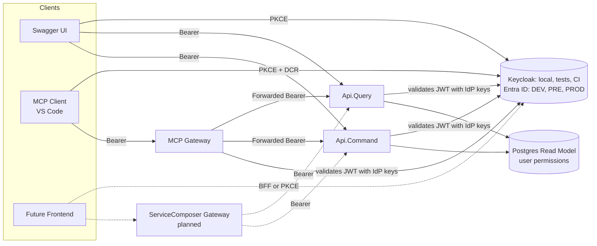
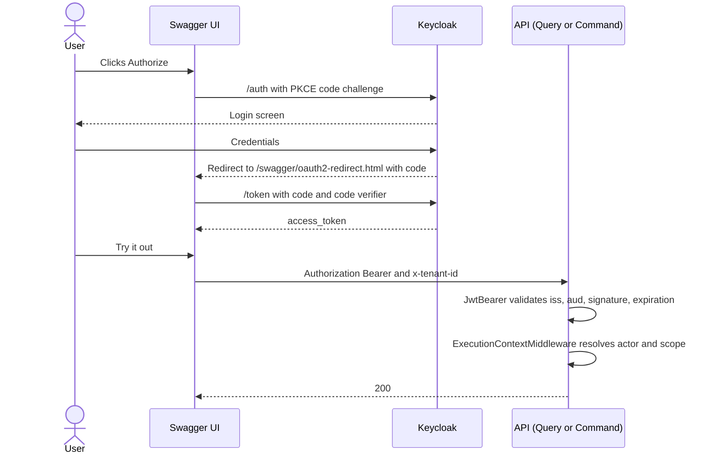
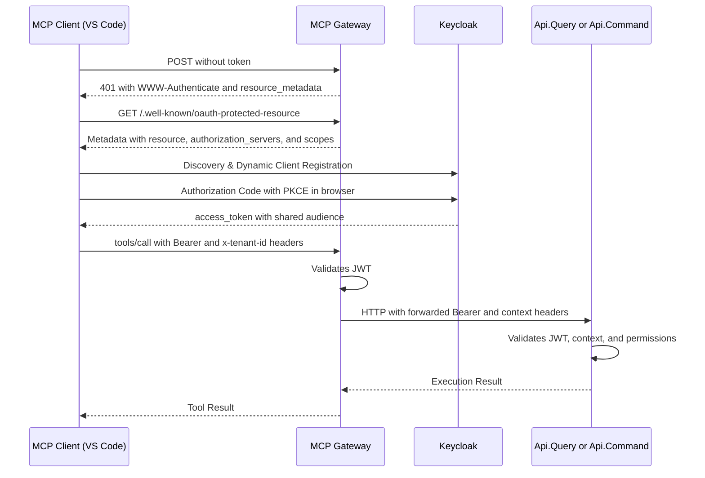

# Authentication in Shared Kernel: Design and Implementation

> Quick and detailed guide to understanding how each request is authenticated and contextualized across the system:
> APIs (Query and Command), Swagger UI, MCP Gateway, gateway ServiceComposer (planned), tests, Keycloak, and Entra ID.

**State of Each Component**

| Component | State |
|---|---|
| Api.Query and Api.Command with JWT (Keycloak locally, Entra ID configured for cloud) | Implemented |
| Swagger UI with Authorization Code + PKCE | Implemented |
| Actor and context resolution (`ExecutionContextMiddleware`) | Implemented |
| Authentication code shared in `SharedKernel.Presentation.HttpRestfulApi` | Implemented |
| Functional tests (fake auth) and System Tests (real Keycloak) | Implemented |
| MCP Gateway with OAuth (resource server) | Implemented (code delivered, pending end-to-end validation with VS Code) |
| Entra ID in DEV/PRE/PROD | Placeholder configuration only, **untested** |
| Gateway ServiceComposer in front of APIs | Planned |

## Table of Contents

1. [Purpose and Scope](#1-purpose-and-scope)
2. [Key Concepts](#2-key-concepts)
3. [Architecture and Responsibility Breakdown](#3-architecture-and-responsibility-breakdown)
4. [How It Works](#4-how-it-works)
5. [Testing](#5-testing)
6. [Design Decisions](#6-design-decisions)
7. [Mental Model](#7-mental-model)
8. [Benefits](#8-benefits)
9. [Edge Cases and Troubleshooting](#9-edge-cases-and-troubleshooting)
10. [Pending Items and Open Risks](#10-pending-items-and-open-risks)
11. [Quick Reference](#11-quick-reference)

---

## 1. Purpose and Scope

**Objective:** Ensure that every request to the APIs (and MCP tools) arrives with the identity of a real user, validated via a JWT issued by an OIDC provider, and that this identity is converted into an execution context (actor, tenant, partition, domain) against which business authorization is applied.

**Requirements Guiding the Design**

- **Two providers, single codebase**: Keycloak locally, in integration/functional tests, and pipelines; Entra ID in cloud environments (DEV → PRE → PROD). The code must remain provider-agnostic.
- **Clean Architecture**: Domain and Application layers know nothing about claims or JWTs. Everything related to authentication lives in the presentation layer; the rest only sees an `ExecutionContext`.
- **Actual authorization resides in each application** (permissions per tenant/partition/domain). The gateway and MCP only authenticate and propagate.
- **No duplicate configuration** across Api.Query, Api.Command, MCP Gateway, and future bounded contexts.
- **Reproducibility with Aspire**: `F5` starts Keycloak pre-configured (imported realm), and APIs receive their configuration directly from the AppHost.

**Out of scope for this document:** Domain authorization (`User` roles/permissions), Redis caching, and internal design of the ServiceComposer gateway.

---

## 2. Key Concepts

| Concept | What It Is in This System |
|---|---|
| **OIDC / OAuth2** | Standard used by Keycloak and Entra ID. Hence, a single `AddJwtBearer` call suffices for both. |
| **JWT (access token)** | Signed token validated by the API: signature, `iss`, `aud`, and expiration. |
| **Authority** | Issuer URL (Keycloak realm or Entra tenant). Metadata and signing keys are downloaded from here. |
| **Issuer (`iss`)** | Who issued the token. Must match the Authority **exactly** (watch out for `localhost` vs. `127.0.0.1`). |
| **Audience (`aud`)** | Who the token is intended for. Decision: a shared audience across the entire backend (`jordiaragonzaragoza.cinema.api`). |
| **`sub` vs. `oid`** | Claim containing the user ID. Keycloak uses `sub`. In Entra, `sub` differs per user **and per application** (pairwise), making `oid` the stable ID. |
| **`MapInboundClaims = false`** | Prevents .NET from renaming claims (e.g., mapping `sub` to a long URI). Claims retain their original names. |
| **Authorization Code + PKCE** | Interactive flow used by Swagger UI and MCP clients. The token is obtained in the browser without a client secret. |
| **Password grant** | Non-interactive flow, **development and System Tests only** (client with *Direct access grants*). |
| **Actor** | Who executes the action: `User` (valid JWT) or `External` (`[AllowAnonymous]` endpoint, identified by IP). |
| **Execution Context** | Actor + `x-tenant-id` + `x-partition-id` + `x-domain-id` + correlation. Built by `ExecutionContextMiddleware`. |
| **Token pass-through** | The gateway/MCP forwards the exact same token it received to downstream APIs. |
| **Protected Resource Metadata (RFC 9728)** | Document from the MCP Gateway telling MCP clients which authorization server issues tokens it accepts. |
| **DCR (Dynamic Client Registration)** | Mechanism allowing an MCP client (VS Code) to self-register with Keycloak. |

---

## 3. Architecture and Responsibility Breakdown



### Projects and Contents Breakdown

| Project | Responsibility | Aware of Keycloak/Entra |
|---|---|---|
| `JordiAragonZaragoza.SharedKernel.Presentation.HttpRestfulApi` | Provider-agnostic JWT Bearer, Swagger, versioning, CORS, pipeline, `ExecutionContextMiddleware`, user claim resolver | **No** |
| **AppHost** (`JordiAragonZaragoza.Cinema`) | Starts Keycloak, imports realm, and **injects auth configuration** into each API/gateway | **Yes** (single location) |
| Api.Query / Api.Command | Register auth + versioning + Swagger using 2 calls to SharedKernel | No |
| MCP Gateway | Validates JWT, publishes OAuth metadata, forwards identity to APIs | No |

---

## 4. How It Works

### 4.1 A Request to an API, Step by Step

Pipeline within `UseWebApplicationConfigurations` (order matters):

1. Developer exception page (Development) or HSTS.
2. `ExceptionMiddleware`.
3. `UseSerilogRequestLogging`.
4. `UseHttpsRedirection`.
5. CORS (only if `ApiOptions.EnableCors = true`).
6. **`UseAuthentication`**: Validates JWT (signature, `iss`, `aud`, expiration). If valid, populates `HttpContext.User`.
7. **`UseAuthorization`**: Applies `[Authorize]`. Base controllers include it; missing/invalid token returns `401`.
8. **`ExecutionContextMiddleware`**: Constructs context (details below).
9. Swagger and Swagger UI (Development only).
10. `MapControllers`.

**`ExecutionContextMiddleware`**

| Scenario | Result |
|---|---|
| Infrastructure endpoint (health, etc.) | Passes through without context |
| Authenticated user with valid user ID claim (GUID) | `User` actor with that ID |
| Authenticated user **without** valid user ID claim | `401` (`unauthorized`) |
| Unauthenticated user on an `[AllowAnonymous]` endpoint | `External` actor, identified by IP |
| Unauthenticated user on a protected endpoint | `401` |
| `User` actor without `x-tenant-id` | `400` (`invalid_tenant`) |
| `External` actor without tenant | Uses system tenant (`SystemTenantId`) |
| `User` actor lacking access to the scope (tenant/partition/domain) | `403` (`forbidden`), via `ValidateScopeAsync` |
| Everything valid | Context set, `x-correlation-id` added to response header, cleared upon completion |

**Three Security Gates in Order:**

1. Who are you? Valid JWT (Authentication, `401`).
2. What context are you acting in, and can you enter it? Tenant, partition, and domain validated against permissions (`400` and `403`).
3. What are you allowed to do there? Domain authorization within handlers and aggregates (outside the scope of this document).

`ValidateScopeAsync` queries the **permissions read model** (`UserAuthorizationReadModel`) in Postgres, which is built by the Projector consuming event store events. This is why Api.Command also requires access to the read model database.

**Context Headers**

| Header | Required | Usage |
|---|---|---|
| `x-tenant-id` | Yes (`User` actors) | Target tenant for the operation |
| `x-partition-id` | No | Data partition |
| `x-domain-id` | No | Domain or context (e.g., a specific cinema) |
| `x-correlation-id` | No | Generated and returned in response if omitted |
| `x-causation-id` | No | Links to the originating event. Internal use: MCP Gateway does **not** forward this |

### 4.2 Swagger UI (Authorization Code + PKCE)



- Mounted in **Development** only (`UseSwagger`/`UseSwaggerUI`).
- Two security schemes, **alternative** (OR, configured as two separate `AddSecurityRequirement` instances):
  `Bearer` (manual token paste, `Http` + `bearer`) and `oauth2` (Keycloak login).
- `oauth2` is only registered if `Swagger:OAuth2` contains `AuthorizationUrl` and `TokenUrl` (`IsConfigured`).
- A single `swagger-ui` client serves all APIs; adding new APIs only requires expanding redirect URIs and Web origins.
- The `AddRequiredHeadersOperationFilter` documents context headers across all endpoints.
- Cross-origin browser calls to Keycloak (token exchange) are handled by client *Web origins*, **not** API CORS settings.

### 4.3 Environment Configuration: Keycloak vs. Entra ID

All differences between providers are strictly **configuration**, zero code changes:

| Key | Local, Tests, and CI (Keycloak) | Cloud (Entra ID) |
|---|---|---|
| `Authentication:Schemes:Bearer:Authority` | Injected by AppHost: `{keycloak}/realms/jordiaragonzaragoza.cinema` | `https://login.microsoftonline.com/<tenant-id>/v2.0` |
| `Authentication:Schemes:Bearer:Audience` | `jordiaragonzaragoza.cinema.api` (AppHost) | API Client ID (GUID) |
| `Authentication:Claims:UserIdClaimType` | `sub` (AppHost) | `oid` (default in `appsettings.json`) |
| `Swagger:OAuth2:AuthorizationUrl` and `TokenUrl` | `.../protocol/openid-connect/auth` and `/token` (AppHost) | Entra `oauth2/v2.0` endpoints, or omitted |
| `Swagger:OAuth2:ClientId` and `Scopes` | `swagger-ui`, `openid`, and `profile` (defaults) | Entra Client ID and scopes |
| `RequireHttpsMetadata` | `false` in Development | `true` (default outside Development) |

**Local Configuration Injection:** AppHost defines `WithKeycloakAuthentication(keycloak)`, which waits for Keycloak health and injects environment variables: `Authentication__Schemes__Bearer__Authority`, `__Audience`, `Authentication__Claims__UserIdClaimType=sub`, and `Swagger__OAuth2__AuthorizationUrl`/`__TokenUrl`. Environment variables take precedence over JSON values, keeping `appsettings.json` clean for production defaults.

**Placeholders:** The `appsettings.json` in each host project contains placeholders (`<tenant-id>`, `<API-client-id>`...). Any value containing `<` is evaluated as **unconfigured** (`IsConfigured`). Outside Development, `ValidateOnStart` causes application startup to fail with an explicit error message rather than failing silently with `401` errors on incoming requests. Validation is bypassed in Development so functional tests (using mock authentication) do not require an active Authority.

**`AddSharedKernelJwtBearerAuthentication`** (Centralized Validation Point)

- `AddJwtBearer` configured with `Authority` and `Audience` retrieved from `Authentication:Schemes:Bearer`.
- Sets `MapInboundClaims = false`.
- Configurable `RequireHttpsMetadata`, defaulting to `!IsDevelopment()`.
- Maintained as a separate method from `AddSharedKernelHttpRestfulApi` so gateway services can validate JWTs without registering API controllers or versioning.

### 4.4 User ID Resolution (`sub` vs. `oid`)

- The middleware does not hardcode a claim name; it uses `IUserIdentifierResolver`, which reads the target claim name from `Authentication:Claims:UserIdClaimType` (`IdentityClaimsOptions`).
- **No fallback** from `oid` to `sub` (or vice versa). In Entra ID, `sub` is pairwise per client application; silently falling back to `sub` would create distinct actor identities for the same user. Each environment must explicitly declare its target claim.
- The claim value must be a valid **GUID**. If invalid, actor resolution fails and returns `401`.

### 4.5 Keycloak

The `jordiaragonzaragoza.cinema` realm is imported using `WithRealmImport("../../containers/keycloak")` pointing to `jordiaragonzaragoza_cinema-realm.json`, with development users predefined in the `users` section.

| Component | Configuration |
|---|---|
| Client `swagger-ui` | Public, Standard flow, PKCE `S256`, redirect URIs `https://localhost:PORT/swagger/oauth2-redirect.html` per API, Web origins, audience mapper |
| Client `cinema-system-tests` | Public, **Direct access grants** (password grant), no Standard flow, audience mapper. Development environment only |
| Client scope `cinema-api-audience` | Mapper `oidc-audience-mapper` (`included.custom.audience` = shared audience, access token only). Added to `defaultDefaultClientScopes` so dynamically registered clients (MCP clients) inherit it automatically |
| User `jordiaragonzaragoza` | `id` = `6bb46b99-e3d1-459b-9e1e-f8d8d7619864` (matches `SeedData.ExampleUserWithAdminRole` so `sub` maps directly to the seeded user), populated `firstName`, `lastName`, and `email`, `emailVerified`, no `requiredActions`, non-temporary password |

Important Details:

- **`sub`** is provided by the `basic` client scope, enabled by default in Keycloak 26.
- **Keycloak 26 and user profiles**: If `firstName`, `lastName`, or `email` are missing, password grant requests fail with `Account is not fully set up`.
- **Audience**: Keycloak does not include `aud` by default. Without the mapper, the API returns `401`.
- **Import executes only when the realm does not exist.** A persistent Keycloak container (`WithDataVolume`) will **not** pick up subsequent changes to the JSON file; you must delete the volume or apply changes manually. System Tests run on fresh containers per execution.
- The password grant is deprecated in OAuth 2.1: acceptable strictly for test users in development environments.

### 4.6 Azure Entra ID

Expected environment configurations (non-secret values; managed via `appsettings`, environment variables, or platform configuration services):

```json
"Authentication": {
  "Schemes": { "Bearer": {
    "Authority": "https://login.microsoftonline.com/<tenant-id>/v2.0",
    "Audience": "<API-client-id>"
  } },
  "Claims": { "UserIdClaimType": "oid" }
}
```

Known Gotchas:

- **Token Version**: Entra defaults to issuing **v1** tokens for APIs (`iss` matching `sts.windows.net`, `aud` formatted as `api://...`). You must explicitly set version 2 in the API app registration manifest (`accessTokenAcceptedVersion` or `api.requestedAccessTokenVersion`, depending on manifest schema version). Otherwise, validation fails due to issuer or audience mismatches.
- **Audience v2** = API Client ID (GUID).
- **Application Tokens** (client credentials): Request `api://<client-id>/.default`, contain `roles` instead of `scp`, and their `oid` represents the service principal. Currently, these tokens resolve as `ActorType.User`. If supported in the future, they must be distinguished via the `idtyp` claim.
- **Cloud Swagger UI** (if enabled): Registration must be configured as a *Single-page application* (PKCE from browser) with scopes formatted as `api://<client-id>/<scope>`.
- **MCP**: Entra does not support Dynamic Client Registration. Requires pre-registered clients.

### 4.7 CORS

- **Disabled on API level** (`ApiOptions.EnableCors = false`). CORS is enforced by browsers, not servers, and APIs are exclusively invoked server-to-server by the gateway and MCP. Swagger UI is served from the same origin as the API.
- Reusable policy logic lives in `CorsExtensions` (`AddSharedKernelCors` and `UseSharedKernelCors`), ready for **gateway reuse** once a frontend is introduced.
- Allowed origins configured via array `Cors:AllowedOrigins` (e.g., `Cors__AllowedOrigins__0`).
- **Fail-closed behavior**: Outside Development, starting the app without configured origins throws a startup exception.
- **Development**: Without configuration, only loopback origins (`localhost`, `127.0.0.1`, `[::1]`) are allowed via an explicit predicate. Replaced `AllowAnyOrigin()` (Sonar S5122 warning resolution).
- **No `AllowCredentials`**: Tokens are transmitted via `Authorization` headers, not cookies. Credentials will only be enabled alongside explicit origin lists if a BFF architecture using cookies is introduced.
- Exposes `x-correlation-id`, `api-supported-versions`, and `api-deprecated-versions` (browsers block custom response headers unless explicitly exposed) and sets `SetPreflightMaxAge` to 1 hour (`x-*` headers trigger preflight requests).

### 4.8 MCP Gateway

The MCP Gateway acts as an **OAuth resource server** per the MCP specification.



**Components**

- `AddMcpGatewayAuthentication`: Reuses `AddSharedKernelJwtBearerAuthentication` and registers the MCP scheme (`AddMcp`) with `ProtectedResourceMetadata`: `Resource` = `Mcp:ResourceUrl`, `AuthorizationServers` = Authority URL, `ScopesSupported` = `openid`, `profile`. Default authentication scheme: JwtBearer; Challenge scheme: MCP.
- Pipeline: `UseAuthentication` and `UseAuthorization` executed **prior** to `MapMcp().RequireAuthorization()`. The MCP scheme handles metadata discovery endpoints and injects `resource_metadata` into `401` responses.
- `WithHttpTransport(options => options.Stateless = true)`: Operates statelessly without in-memory sessions, ensuring horizontal scaling across AKS replicas without session affinity. Guarantees `IHttpContextAccessor` always exposes valid `HttpContext`.
- `AuthorizationDelegatingHandler` (registered in typed Command/Query HTTP clients) forwards incoming request context to downstream APIs: `Authorization`, `x-tenant-id`, `x-partition-id`, `x-domain-id`, and `x-correlation-id`. Strict allow-list enforcement: `x-causation-id` is explicitly excluded from forwarding.
- `ExceptionHandlingFilters`: Intercepts `401` or `403` API responses and translates them into descriptive `McpException` instances with LLM-actionable error messages (explaining scope/permission errors) instead of generic `EnsureSuccessStatusCode` failures.
- Required Keycloak setup: Default audience client scope at realm level (dynamic clients lack individual audience mappers) and a DCR policy allowing `localhost` and `127.0.0.1` (*Trusted Hosts*).
- `mcp.json` context header configuration:

```json
"headers": {
  "x-tenant-id": "667196fc-0e17-43f9-990d-7dc2175e6162",
  "x-partition-id": "05cbd871-da4e-447b-9d62-89438df8c4a8",
  "x-domain-id": "497cd8f1-620c-426f-992d-7012147f6e7c"
}
```

Clients asserting tenant IDs present no security risk: downstream APIs validate that the authenticated user actually holds access rights to the target scope.

### 4.9 Gateway ServiceComposer (Planned)

- Validates tokens **at the edge** and forwards them downstream (pass-through) using a shared audience.
- A single propagation `DelegatingHandler` handles token and context header forwarding, eliminating the risk of individual composition handlers forgetting to forward context headers. Generates `x-correlation-id` if missing from client requests.
- Downstream APIs **must not be publicly accessible outside the gateway** (network isolation): this isolation ensures the security of using a shared audience.
- Will reuse `AddSharedKernelJwtBearerAuthentication` and `CorsExtensions` (CORS will be handled by the gateway once a frontend is implemented). For SPAs, the BFF pattern (using `HttpOnly` cookies and injecting tokens on internal calls) will be evaluated.

---

## 5. Testing

| Level | Authentication Strategy | Rationale |
|---|---|---|
| **Functional** (`WebApplicationFactory`, Testcontainers) | **Mocked**: `AuthHandler` | Validates internal pipeline mechanics without requiring real Keycloak JWT issuance. Fast and deterministic |
| **System Tests** (Aspire Testing, full topology) | **Real Keycloak** | Exercises end-to-end user flows: real JWT validation, issuer, audience, `sub`, and permission checks |

### 5.1 Functional Tests

- `AuthHandler` (registering scheme `Test`) authenticates requests carrying `Authorization: Test {userId}`; all other requests remain unauthenticated, effectively testing `401` execution paths.
- User ID claims are issued using the **configured claim name** (`IOptions<IdentityClaimsOptions>`), avoiding hardcoded `sub` references. Tests run using production-like settings (`oid`).
- Inside `CustomWebApplicationFactory`, `ConfigureTestServices` overrides authentication with `AuthHandler` as default scheme; JWT Bearer remains registered in DI but is bypassed.
- `FunctionalTestsFixture.CreateClient(authenticated)` automatically appends authorization and context headers.
  - **Api.Query**: `x-tenant-id` set to `SystemConstants.SystemTenantId`.
  - **Api.Command**: Sets `x-tenant-id`, `x-partition-id`, and `x-domain-id` matching seed entities (`ExampleTenant`, `ExamplePartition`, `ExampleCinema`) associated with user `ExampleUserWithAdminRole`.
- **Api.Command requires Postgres** alongside KurrentDB: `ValidateScopeAsync` queries the permission read model. The test fixture manages the Postgres container via Testcontainers and seeds `UsersAuthorizations` without external `ScopeInfo`, scoping permissions directly to seed values.

### 5.2 System Tests

- `SystemTestsFixture` starts the AppHost with `IsTesting=true`, **waits for Keycloak health readiness**, and retrieves tokens via `KeycloakTokenClient` (password grant, client `cinema-system-tests`, user `jordiaragonzaragoza`).
- `KeycloakTokenClient` implements retries for transient failures (`404` when realm import is in progress, `5xx` server errors, network failures) and fails immediately on `4xx` configuration errors, logging the response body.
- Pre-configured `HttpClient` instances targeting Command and Query APIs automatically include `Authorization: Bearer` and context headers on all outgoing requests.
- Token requests target `localhost:8080`, matching the Authority URL used by APIs; host mismatches will cause `iss` validation failures.
- **Missing Realm Errors** (`Realm does not exist`): Typically caused by mounting `--tmpfs` over `/opt/keycloak/data` during testing, which masks the `/opt/keycloak/data/import` mount. Resolution: Remove `tmpfs` targeting Keycloak containers (using `ContainerLifetime.Session` keeps container state ephemeral without volumes).

---

## 6. Design Decisions

| # | Decision | Rejected Alternatives | Rationale | Consequence |
|---|---|---|---|---|
| 1 | **Single configuration-driven `AddJwtBearer`** for both Keycloak and Entra ID | Provider-specific extension classes, Aspire `AddKeycloakJwtBearer` | Both implement OIDC. Keeps a single unified validation pipeline across environments | Switching providers requires configuration changes only. Removes `Aspire.Keycloak.Authentication` dependency |
| 2 | **Explicit environment-based user claim mapping** (`UserIdClaimType`) | Fallback logic from `oid` to `sub`; using `sub` universally | `sub` is pairwise in Entra ID; falling back implicitly would create duplicate actors | Environments must explicitly define their claim. Eliminates implicit magic |
| 3 | **`MapInboundClaims = false`** | Retaining standard .NET claim mapping and querying full URI strings | Preserves clean claim names matching output from jwt.io | Code accessing `User.Identity.Name` requires explicit `NameClaimType` setup |
| 5 | **Configuration-driven Swagger endpoints/scopes** (`Swagger:OAuth2`) | Hardcoding Keycloak endpoint paths in code | Keycloak and Entra ID use different endpoint patterns | AppHost injects values locally; cloud environments use `appsettings` or omit OAuth |
| 6 | **Single `swagger-ui` client for all APIs** | Registering dedicated clients per API | Client defines *who* requests tokens; Audience defines *which API* receives them | Adding APIs only requires adding redirect URIs and Web origins |
| 7 | **Shared Audience** (`jordiaragonzaragoza.cinema.api`), configurable per API | Unique audience per bounded context | Single trust boundary, single team, simplifies cross-context calls | A token issued for Cinema is accepted across APIs. Mitigated via network isolation. Payments can be isolated later |
| 8 | **Token pass-through** (Gateway & MCP) | Token exchange / On-Behalf-Of | Simplicity and consistency with the shared audience strategy | Deviation from strict MCP security guidelines (see risks). Isolated within a single `DelegatingHandler` |
| 9 | **Application-level authorization enforcement** (context + domain) | Centralized authorization at gateway level | Gateways should not evaluate business logic rules | APIs validate tenant/scope boundaries regardless of client-supplied headers |
| 10 | **Disabled CORS on APIs**, reusable fail-closed policies | Open CORS with credentials | Server-to-server calls; no `AllowCredentials` needed with Bearer auth | CORS logic is applied at gateway level when frontend is added |
| 11 | **Startup failure** on missing Authority/Audience (outside Development) with placeholders treated as invalid | Deferred failure on first request | Catch configuration defects during deployment pipelines | Validation is skipped in Development for functional tests |
| 12 | **Mock auth for functional tests; real Keycloak for System Tests** | Real Keycloak across all test suites | Speed and determinism vs. complete protocol fidelity | Cloud-specific Entra behavior must be validated via smoke tests in PRE |
| 13 | **Password grant limited to dev clients** | Automated browser login UI interaction | Provides a non-interactive equivalent issuing realistic JWT tokens | Imported in F5 mode: do not export this realm to production environments |
| 14 | **Stateless MCP Gateway** | In-memory session tracking | Enables horizontal scaling in AKS and ensures reliable `HttpContext` availability | Tools cannot rely on stateful session capabilities |

---

## 7. Mental Model

1. **The IdP is an interchangeable token provider.** To application code, Keycloak and Entra ID are identical: an Authority, an Audience, and a target claim name. Everything else is environment-injected configuration (AppHost locally, `appsettings` or environment variables in cloud).
2. **Three Security Gates**: Identity (JWT), Context (tenant and scope), and Domain permissions. Each gate fails with a distinct status code: `401`, `400`, or `403`, plus domain-specific errors.
3. **Tokens belong to users, not services.** The Gateway, MCP, and APIs act on behalf of the user by forwarding their token. Background workers and machine-to-machine calls should use client credentials (one client per **caller**, not per target).
4. **Client vs. Audience**: The client represents *who* is requesting access; the audience represents *for whom* the request is intended. Hence, there is one client per *tool* (Swagger, System Tests) and one audience per *backend*.
5. **AppHost acts as the local environment's "constitution"**: It defines Keycloak settings and passes them to downstream projects. SharedKernel never imports Keycloak-specific packages.
6. **Tests choose their realism level**: Mock authentication tests pipeline logic rapidly; real Keycloak tests validate contracts completely.

---

## 8. Benefits

- **Single validation path** across local, CI, and production environments: System Tests running Keycloak exercise the exact code executed against Entra ID.
- **Provider changes require zero code modifications**: Fully configuration-driven.
- **Zero code duplication**: Query, Command, MCP, and future bounded contexts share common extensions.
- **Clean Domain and Application layers**: Completely decoupled from claims or JWT dependencies.
- **Early and explicit error feedback**: Invalid configurations fail at application startup; HTTP status codes explicitly differentiate `401`, `400`, and `403`.
- **Secure defaults by design**: CORS disabled on APIs, no `AllowCredentials`, fail-closed CORS policies, fixed `MapInboundClaims`, strict allow-list for header propagation.
- **Reproducible F5 developer experience**: Keycloak starts pre-populated with realms and users, auto-configured via AppHost.
- **Scalable architecture**: Stateless MCP handling without session affinity requirements.
- **Future-proof design**: Seamlessly accommodates token exchange (Payments, MCP), BFF implementations, or per-context audiences without architectural rewrites.

---

## 9. Edge Cases and Troubleshooting

| Symptom | Probable Cause | Action |
|---|---|---|
| `401` with a token that appears valid on jwt.io | Missing `aud` claim: missing audience mapper on client or scope | Add audience mapper (or assign default client scope) |
| `401` due to mismatched `iss` | Token requested using `127.0.0.1` or host differing from Authority | Consistently use `localhost:8080` across configuration |
| `401` and missing `sub`/`oid` claim | `UserIdClaimType` mismatch (e.g., expecting `oid` from Keycloak) or missing `MapInboundClaims = false` | Align configured claim settings with active provider |
| `401` despite claim being present | Claim value is not a valid GUID | User ID values must be formatted as GUIDs |
| `400 invalid_tenant` | Missing `x-tenant-id` header | Supply header (Swagger prompts for it; MCP reads from `mcp.json`) |
| `403 forbidden` | User lacks permissions for tenant/partition/domain, or permission projection is lagging (eventual consistency) | Check user seed/`sub`; in System Tests, wait for projection to process |
| API startup fails in cloud | Missing Authority/Audience or left as `<placeholder>` | Set valid environment variables |
| First authenticated request fails in Dev without AppHost | Authority set to placeholder: skipped startup validation | Run application using AppHost |
| `Account is not fully set up` on token request | Keycloak user missing `firstName`, `lastName`, `email`, or has pending actions | Complete profile fields and clear `requiredActions` |
| `Realm does not exist` | Realm not imported (persistent volume with old data, or mount masked by `tmpfs`) | Clear persistent volume or remove `tmpfs` settings from Keycloak |
| Realm JSON changes not applying on F5 | Import does not re-run if realm exists in volume | Clear persistent volume or update realm manually |
| Token expires during System Tests execution | Default token lifetime is 5 minutes | Increase `accessTokenLifespan` in dev realm or implement `DelegatingHandler` refresh |
| Swagger: `Invalid parameter: redirect_uri` | Redirect URI mismatch (scheme, host, or port) | Register exact redirect URI per API |
| Swagger: Login succeeds but token exchange fails | Missing *Web origins* configuration on client | Add API origin to client Web origins list |
| Swagger sends token to anonymous endpoints | Security requirement applied globally | Harmless behavior; refine using custom `IOperationFilter` if necessary |
| MCP: `401` missing `resource_metadata` | `UseAuthentication` placed after `MapMcp`, or missing `RequireAuthorization` | Check middleware pipeline execution order |
| MCP: Client cannot discover authorization server | `Mcp:ResourceUrl` mismatch with client URL, or Authority unreachable from browser | Align network URLs across environments |
| MCP: Dynamic client registration fails in Keycloak | *Trusted Hosts* policy restricting anonymous registration | Allow `localhost` and `127.0.0.1` (evaluate *Allowed Client Scopes*), or pre-register public client |
| MCP: API receives `401` from tool invocations | Null `HttpContext` (missing `Stateless`) or missing handler in typed client | Ensure `Stateless = true` and `.AddHttpMessageHandler<AuthorizationDelegatingHandler>()` |
| Entra application token processed as User actor | Resolver does not evaluate `idtyp` claim | Update resolver logic if application tokens are accepted |
| Entra returns `401` due to issuer/audience mismatch | Receiving v1 tokens | Enforce version 2 tokens in API application manifest |
| CORS failure with empty `Cors:AllowedOrigins` in cloud | Fail-closed policy triggered at startup | Configure origin array (required if `EnableCors` is true) |

---

## 10. Pending Items and Open Risks

| Topic | Detail |
|---|---|
| **Token pass-through in MCP** | MCP security specification discourages forwarding incoming user tokens to downstream APIs (risk of *confused deputy* attacks). Currently accepted due to shared backend audience and single trust boundary. Transitioning to token exchange (Keycloak) or On-Behalf-Of (Entra ID) is isolated inside `AuthorizationDelegatingHandler`. |
| **Untested Entra ID** | Local and CI environments do not cover Entra-specific token differences (v1 vs. v2 tokens, `oid` vs. `sub`, `scp` vs. `scope`). Recommendation: Implement a smoke test in PRE against Entra ID executing an authenticated call to verify actor resolution. |
| **MCP with Entra ID** | Entra ID does not support DCR; requires pre-registering clients and adjusting MCP client authorization flows. |
| **End-to-End MCP Validation** | Pending validation using VS Code: Keycloak DCR policy, default audience scopes, and precise SDK types (`ProtectedResourceMetadata` uses string types in current version; `Stateless` behavior depends on SDK release). |
| **Eventual Consistency in Permissions** | `ValidateScopeAsync` queries a read model built asynchronously by the Projector: transient `403` responses can occur immediately after seeding data. |
| **ServiceComposer Gateway** | Pending development: Context/token propagation handler, edge token validation, CORS enforcement, and API network isolation. |
| **Per Bounded Context Audiences** | If specific contexts (e.g., Payments) require isolation, transition to context-specific audiences and token exchange; audience configuration is already supported per API. |
| **Machine-to-Machine (M2M) Application Tokens** | Currently resolve as `User` actors; explicit service actor types should be defined if app tokens are officially supported. |
| **Caching (Out of Scope)** | `CacheService.GetAsync` never yields cache hits, leaving cache in a write-only state; evaluation deferred. |

---

## 11. Quick Reference

### Configuration Keys

| Key | Used By | Notes |
|---|---|---|
| `Authentication:Schemes:Bearer:Authority` | All APIs and MCP Gateway | Required outside Development |
| `Authentication:Schemes:Bearer:Audience` | All APIs and MCP Gateway | Required outside Development |
| `Authentication:Schemes:Bearer:RequireHttpsMetadata` | JwtBearer | Defaults to `!IsDevelopment()` |
| `Authentication:Claims:UserIdClaimType` | Api.Query and Api.Command | `oid` (Entra ID) or `sub` (Keycloak) |
| `Swagger:OAuth2:AuthorizationUrl`, `TokenUrl`, `ClientId`, `Scopes` | Swagger UI | If URLs are missing, falls back to manual scheme only |
| `Cors:AllowedOrigins` (array) | Any host enabling CORS | Required only if `EnableCors` is true |
| `Mcp:ResourceUrl` | MCP Gateway | Must match public client URL |

### Constants (Cinema.SharedKernel)

`Keycloak` = `"Keycloak"` · `KeycloakRealm` = `"jordiaragonzaragoza.cinema"` · `KeycloakAudience` = `"jordiaragonzaragoza.cinema.api"` · `KeycloakImageTag` = `"26.8"`

### Method Invocations

| Component | Method |
|---|---|
| API (Services) | `AddSharedKernelJwtBearerAuthentication(...)` and `AddSharedKernelHttpRestfulApi(..., new ApiOptions { Title = ... })` |
| API (Pipeline) | `UseSharedKernelHttpRestfulApi()` |
| AppHost | `.WithKeycloakAuthentication(keycloak)` on each project builder |
| MCP Gateway | `AddMcpGatewayAuthentication(...)`, `MapMcp().RequireAuthorization()`, and `AuthorizationDelegatingHandler` |
| Functional Tests | `AuthHandler` + `CreateClient(authenticated)` |
| System Tests | `KeycloakTokenClient` + `SystemTestUser` |

### Useful Seed Values for Testing

| Entity | Value |
|---|---|
| Admin User (`sub` in Keycloak) | `6bb46b99-e3d1-459b-9e1e-f8d8d7619864` |
| Example Tenant | `667196fc-0e17-43f9-990d-7dc2175e6162` |
| Example Partition | `05cbd871-da4e-447b-9d62-89438df8c4a8` |
| Example Cinema (Domain) | `497cd8f1-620c-426f-992d-7012147f6e7c` |

### Key Source Files

- SharedKernel: `JwtBearerAuthenticationExtensions`, `HttpRestfulApiServiceCollectionExtensions`, `HttpRestfulApiApplicationExtensions`, `ConfigureSwaggerOptions`, `SwaggerOAuth2Options`, `ApiOptions`, `CorsExtensions`, `AddRequiredHeadersOperationFilter`, `ExecutionContextMiddleware`, `IdentityClaimsOptions`.
- AppHost: `Program.cs`, `KeycloakAuthenticationExtensions`.
- MCP Gateway: `Program.cs`, `McpAuthenticationExtensions`, `ConfigureWebApplication`, `AuthorizationDelegatingHandler`, `InfrastructureDependencyInjection`, `ExceptionHandlingFilters`.
- Tests: `AuthHandler`, `FunctionalTestsFixture` (Query and Command), `CustomWebApplicationFactory`, `SystemTestsFixture`, `KeycloakTokenClient`, `SystemTestUser`.
- Realm: `containers/keycloak/jordiaragonzaragoza_cinema-realm.json`.